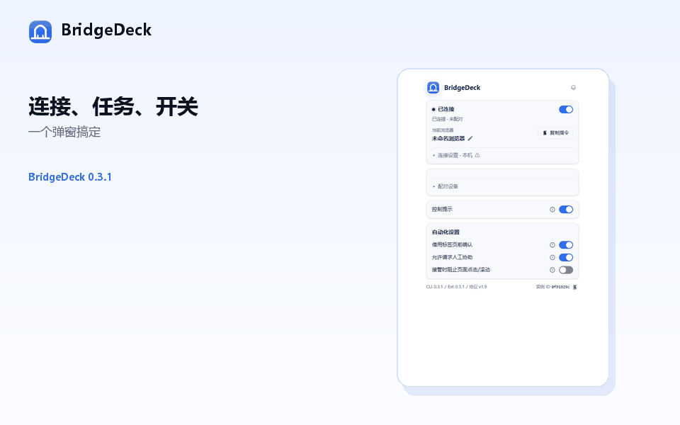

# BridgeDeck

<p align="center">
  
</p>

<p align="center">
  <strong>浣犵殑 Agent锛屼綘鐨勬祻瑙堝櫒锛屼竴鏉¤繛鎺ャ€?/strong><br />
  鎶婂凡缁忕櫥褰曠殑娴忚鍣ㄥ彉鎴?Agent 鐨勫伐浣滃尯銆?</p>

<p align="center">
  <a href="https://microsoftedge.microsoft.com/addons/detail/ieflpefpmlmmlfgmpfakaglhgmcbcnig">
  </a>
  <a href="https://github.com/iorl566/bridgedeck/releases/latest"></a>
  <a href="LICENSE"></a>
  
</p>

<p align="center">
  <a href="#鐪嬬湅瀹為檯鏁堟灉">鐪嬬湅瀹為檯鏁堟灉</a> 路
  <a href="#鑳藉仛浠€涔?>鍔熻兘</a> 路
  <a href="#瀹夎">瀹夎</a> 路
  <a href="#绗竴涓换鍔?>绗竴涓换鍔?/a> 路
  <a href="#娴忚鍣ㄦ帶鍒朵笌闅愮">闅愮</a> 路
  <a href="#鏂囨。瀵艰埅">鏂囨。</a> 路
  <a href="docs/releases/0.3.1.md">鏇存柊鏃ュ織</a>
</p>

**BridgeDeck 鎶婁綘鐨?AI Agent 杩炴帴鍒?Chrome 鎴?Microsoft Edge锛岀洿鎺ヤ娇鐢ㄤ綘宸叉湁鐨勭櫥褰曠姸鎬併€?* 浜ょ粰瀹冭鍙栥€佺偣鍑汇€佸～琛ㄦ垨鎺掓煡闂锛涗换鍔″湪鐙珛鐨?**Agent Window** 涓繍琛岋紝闇€瑕佹椂鐢变綘鎺ユ墜銆傚凡鏈夋爣绛鹃〉闇€瑕佹樉寮忓€熺敤锛屼换鍔＄粨鏉熷悗褰掕繕銆傞粯璁ゅ彧杩炴帴鏈満 daemon锛屼笉缁忚繃浜戠銆?
## 鐪嬬湅瀹為檯鏁堟灉

<p align="center">
  
</p>

<p align="center">
  <sub>寮圭獥 鈫?鎺ョ娴眰锛堣摑鑹插懠鍚歌竟妗?+ 鍗＄墖锛夆啋 蹇嵎鍔熻兘锛屽叏閮ㄦ槸鐪熷疄鐣岄潰銆?/sub>
</p>

## 鐢ㄤ綘鐔熸倝鐨?Agent

BridgeDeck 涓嶇粦瀹氭ā鍨嬶紝涔熶笉瑕佹眰鎹?Agent銆傚彧瑕佽兘璋冪敤鏈湴鍛戒护锛屽氨鑳介€氳繃鍚屼竴涓?`bridge` CLI 浣跨敤锛?
| 鎺ュ叆鏂瑰紡 | 鍏ュ彛 | 閫傚悎 |
| --- | --- | --- |
| **CLI** | `bridge` / `node cli/bridge.mjs` | Codex銆丆laude Code銆丆ursor 绛夎兘璺?Shell 鐨?Agent |
| **MCP** | `node mcp/server.mjs`锛?1 涓伐鍏凤級 | 鏀寔 MCP 鐨勫鎴风 |
| **DSH 鎻掍欢** | `dsh-plugin/`锛?5 涓伐鍏凤級 | DeepSeek Harness锛屽甫浠诲姟棰勮涓庢埅鍥剧粨鏋?|
| **Node/Python SDK** | `import { connect } from 'browser-bridge/sdk'` / `sdk/python/browser_bridge.py` | 鍐?Node/TypeScript 鎴?Python 鑴氭湰銆侀泦鎴愭祴璇?|
| **鍐呭祵鎶€鑳?* | `bridge install-skill` | 鏀寔 skill 鐨勫涓伙紝涓€鏉″懡浠よ涓婁娇鐢ㄨ鏄?|
| **鏂滄潬鍛戒护** | `bridge install-skill --harness <id> --commands` | Claude Code / Codex / Cursor 绛夋妸鎶€鑳藉寘瑁呮垚 `/browser-bridge` |

`install-skill` 鍙啓 `SKILL.md` + `references/`锛岃繖鏄嚜鍔ㄥ彂鐜?妯″瀷璋冪敤鐨勬妧鑳芥牸寮忥紱鏂滄潬鍛戒护鏄涓昏嚜宸辩殑鍛戒护灞傦紝闇€瑕?`--commands` 棰濆鐢熸垚锛?
```powershell
bridge install-skill --harness claude-code --commands   # ~/.claude/commands/browser-bridge.md
bridge install-skill --harness codex --commands         # ~/.codex/prompts/browser-bridge.md
bridge install-skill --harness cursor --commands        # ~/.cursor/commands/browser-bridge.md
```

DSH 涓嶉渶瑕佸懡浠ゆ枃浠讹細鎻掍欢浼氶€氳繃 skills 鏈嶅姟娉ㄥ唽鍐呭祵鎶€鑳斤紝鐩存帴 `/browser-bridge` 浣跨敤銆?
## 鑳藉仛浠€涔?
| 浣犳兂瀹屾垚鐨勪簨 | BridgeDeck 濡備綍甯繖 |
| --- | --- |
| **鐢ㄥ凡鏈夎处鍙凤紝鍋氱綉绔欎换鍔?* | 澶嶇敤娴忚鍣ㄧ櫥褰曟€侊紝璇诲彇鏂囨。銆佹悳绱㈠唴閮ㄧ綉绔欙紝瀹屾垚闇€瑕佺櫥褰曠殑缃戦〉娴佺▼銆?|
| **涓€鍙ユ寚浠わ紝钀藉疄鍒版搷浣?* | VOM/AX 寮曠敤銆佺偣鍑汇€佸～鍐欍€侀€夋嫨銆佹嫋鎷姐€佹粴杞€佷笂浼犱笅杞姐€佸彲淇¤緭鍏ワ紱鎴彇鍙鍖哄煙鎴栨暣椤点€俒鑳藉姏鐭╅樀](docs/FUNCTION-MATRIX.md) |
| **Agent 鎿嶄綔锛屼綘鏉ユ帉鎺?* | 鍏变韩鎺у埗銆佷汉宸ヨ緭鍏ユ娴嬨€佹殏鍋?浜ゅ洖銆佸€熺敤鏍囩椤电‘璁わ紱浠诲姟鍦ㄧ嫭绔嬬獥鍙ｉ噷鍙杩愯銆俒鎺ョ娴眰](#娴忚鍣ㄦ帶鍒朵笌闅愮) |
| **缃戦〉琛ㄦ牸锛屽鍑哄嵆鐢?* | 琛ㄦ牸/鍒楄〃鎻愬彇涓?JSON/CSV锛屼繚鐣欏垪鍚嶃€侀〉闈?iframe 鏉ユ簮銆佸悎骞跺崟鍏冩牸涓庤鐩栬寖鍥淬€俒缁撴瀯鍖栨彁鍙朷(docs/architecture.md) |
| **鎿嶄綔鍑洪敊锛屾壘鍒扮嚎绱?* | 鍏宠仈鎿嶄綔銆佽姹傘€佸搷搴旀鏂囥€佹帶鍒跺彴涓庨〉闈㈠彉鍖栵紝妫€鏌ユ€ц兘涓庣枒浼奸噸澶嶈姹傦紝鐢ㄨ鍒欐垨閲嶆斁楠岃瘉銆俒缃戠珯璋冭瘯](docs/website-debugging.md) |
| **褰曚笅杩囩▼锛岄殢鏃跺洖鐪?* | 鎶婁竴涓凡鎺堟潈鐨勪换鍔℃爣绛鹃〉褰曞埗涓烘棤澹?MP4锛屽湪鎵╁睍閲岄瑙堛€佷繚瀛樻垨鍒犻櫎銆俒浠诲姟瑙嗛](docs/video-recording.md) |
| **鏁撮〉鐣欐。** | 鑷姩婊氬姩銆佹墜鍔ㄦ嫾鎺ャ€佷粎鍙鍖哄煙涓夌闀挎埅鍥炬ā寮忥紱鏃犻渶 Agent 涔熻兘鐢ㄣ€俒闀挎埅鍥綸(docs/long-screenshot.md) |
| **椤甸潰灏辩华锛屽啀鍋氫笅涓€姝?* | `wait-for-element`銆乣wait-for-navigation`銆乣--settle`锛岄伩鍏?鐐瑰お鏃?銆俒鎺掗殰](docs/troubleshooting.md) |
| **宸茬粡瑙傚療锛屾寜闇€澶嶇敤** | `observe --save-full` 鍚庣敤 `view` 鎼滅储鍘嗗彶瑙傚療锛屼笉鍐嶉噸鏂版姄椤甸潰銆俒鏋舵瀯涓庢暟鎹祦](docs/architecture.md) |
| **娴忚鍣ㄤ笌璐﹀彿锛岄€夊鍐嶅紑宸?* | 娴忚鍣ㄥ疄渚嬪懡鍚嶃€乻ession 缁戝畾銆佹爣绛鹃〉绉诲姩锛涗篃鍙互璁╂湇鍔″櫒涓婄殑 Agent 杩炴帴鏈満娴忚鍣ㄣ€俒鏈湴閰嶅](docs/local-pairing.md) |
| **浠诲姟缁撴潫锛岃褰曞彲鏌?* | 鎿嶄綔瀹¤榛樿鍏抽棴锛屽紑鍚悗鍙寜浠诲姟鍥炵湅姣忎竴姝ャ€俒鎿嶄綔瀹¤](docs/operation-audit.md) |

## 瀹夎

BridgeDeck 鐢变笁閮ㄥ垎缁勬垚锛?*娴忚鍣ㄦ墿灞?+ 鏈満 daemon + CLI**銆傛墿灞曡礋璐ｆ搷浣滈〉闈紝daemon 涓?CLI 璐熻矗鎶婅兘鍔涗氦缁?Agent銆?
### 鏂规 A锛氬晢搴椾竴閿畨瑁咃紙鎺ㄨ崘锛?
鍦?Microsoft Edge 鍔犺浇椤瑰晢搴楀畨瑁?**BridgeDeck**锛?
**[瀹夎 Edge 鎵╁睍](https://microsoftedge.microsoft.com/addons/detail/ieflpefpmlmmlfgmpfakaglhgmcbcnig)**

鎵╁睍瑁呭ソ鍚庢墦寮€寮圭獥锛岀‘璁ゆ樉绀?**宸茶繛鎺?*銆俤aemon 浼氬湪绗竴娆℃墽琛?`bridge` 鍛戒护鏃惰嚜鍔ㄦ媺璧枫€?
Chrome Web Store 鏆傛湭涓婃灦锛汣hrome 鐢ㄦ埛鍙厛鐢ㄥ紑鍙戣€呮ā寮忓姞杞?`extension/`锛屾垨瑙ｅ帇鍙戝竷椤电殑 `BridgeDeck-extension-*.zip` 鍚庡姞杞姐€?
### 鏂规 B锛氫竴琛屽懡浠ゅ畨瑁咃紙Windows锛?
```powershell
irm https://raw.githubusercontent.com/iorl566/bridgedeck/main/install-online.ps1 | iex
```

鑴氭湰浼氭煡璇㈡渶鏂板彂甯冨寘銆佸畨瑁呭埌 `%LOCALAPPDATA%\BridgeDeck`銆佺敓鎴?`bridge` 鍛戒护骞惰嚜妫€锛涢渶瑕佽嚜瀹氫箟鐩綍鏃讹細

```powershell
.\install-online.ps1 -Dest D:\Apps\BridgeDeck -AddToPath
```

涔熷彲浠ヤ粠 [Releases](https://github.com/iorl566/bridgedeck/releases/latest) 鎵嬪姩涓嬭浇 `BridgeDeckSetup-0.3.0.exe` 鎴?`BridgeDeck-cli-0.3.0-win32-x64.zip`銆傚畨瑁呭櫒鐩墠鏄嚜绛惧悕锛學indows 浼氭樉绀?鏈煡鍙戝竷鑰?锛涘彂甯冩祦姘寸嚎鏀寔 EV 绛惧悕锛岃瘉涔﹂厤缃 [Windows 绛惧悕](docs/windows-signing.md)銆?
### 鏂规 B2锛歮acOS / Linux

浠?[Releases](https://github.com/iorl566/bridgedeck/releases/latest) 涓嬭浇瀵瑰簲鏋舵瀯鐨勫寘锛?
```sh
# macOS锛圓pple Silicon / Intel锛変笌 Linux锛坸64 / arm64锛?tar -xzf BridgeDeck-cli-0.3.0-darwin-arm64.tar.gz   # 鎴?darwin-x64 / linux-x64 / linux-arm64
cd BridgeDeck-cli-0.3.0-darwin-arm64
sh install.sh --add-to-path
bridge status
```

macOS 涔熷彲浠ュ畨瑁呯鍚嶅苟鍏瘉鐨?`.pkg`锛堢敱鍙戝竷娴佹按绾跨敓鎴愶級锛氬弻鍑诲畨瑁呭悗杩愯 `bridge status`銆俙.pkg` 瑁呭埌 `/usr/local/lib/bridgedeck`锛屾洿鏂版椂闇€瑕?`sudo bridge update install ...`锛涗笉鎯崇敤 sudo 灏辩敤涓婇潰鐨?`tar.gz` + `install.sh` 瑁呭埌鐢ㄦ埛鐩綍銆?
鏈叕璇佺殑 `tar.gz` 棣栨杩愯鍙兘琚?Gatekeeper 鎷︽埅锛屽彲鍦ㄢ€滅郴缁熻缃?鈫?闅愮涓庡畨鍏ㄦ€р€濋噷鍏佽锛屾垨鏀圭敤 `.pkg`銆?
Linux 榛樿瀹夎鍒?`${XDG_DATA_HOME:-$HOME/.local/share}/bridgedeck`锛岀敤 `--dest` 鏀圭洰褰曪紱`--add-to-path` 浼氶摼鎺ュ埌 `~/.local/bin/bridge`銆?
<details>
<summary><b>鏂规 C锛氫粠婧愮爜鍔犺浇锛堝紑鍙戠敤锛?/b></summary>

1. 鍏嬮殕浠撳簱骞剁‘璁?Node.js 20+锛堟帹鑽?24锛夈€?2. 鎵撳紑 `edge://extensions`锛屽紑鍚?寮€鍙戣€呮ā寮?銆?3. 閫夋嫨"鍔犺浇宸茶В鍘嬬殑鎵╁睍"锛屾寚鍚?`extension/`銆?4. 鍦ㄦ墿灞曡鎯呴〉鍏佽鏃犵棔妯″紡锛堝闇€瑕?InPrivate锛夈€?5. 杩愯 `node cli/bridge.mjs doctor` 鑷锛屽啀鎵ц `node cli/bridge.mjs status`銆?
</details>

### 鏂规 D锛氳 Agent 鑷繁瑁?
鎶婁笅闈㈣繖鍙ヨ瘽鍙戠粰浣犵殑 Agent锛?
```text
Set up BridgeDeck on this machine by following
https://raw.githubusercontent.com/iorl566/bridgedeck/main/AGENT_INSTALL.md
```

Agent 浼氭寜鎸囧崡鎶?CLI 涓?daemon 瑁呭埌鐢ㄦ埛鐩綍锛坄%LOCALAPPDATA%\BridgeDeck`锛屽彲鐢?`-Dest` 鏀癸級锛屽啀寮曞浣犺鎵╁睍鎴栬嚜琛岃В鍘嬪姞杞斤紱涓嶄細鍐欐鐩樼锛屼篃涓嶄細鍔ㄤ綘鐨勫叾瀹冩枃浠躲€傚畨瑁呬笌楠岃瘉姝ラ瑙?[AGENT_INSTALL.md](AGENT_INSTALL.md)銆?
## 鎵撳寘涓庝綋绉?
鍙戝竷鎵╁睍鍖呬娇鐢?*鎴戜滑鑷繁鐨勬簮鐮佹爲鎵撳寘**锛坄node tools/build-extension.mjs`锛夛細鎶?`extension/` 閫愭枃浠?鏍￠獙鍚庢墦鎴?`dist/BridgeDeck-extension-<version>.zip`锛堝綋鍓?**426 涓枃浠?/ 绾?3.6 MB**锛夛紝淇濇寔妯″潡杈圭晫銆?鏂逛究瀹℃牳涓庢寜鏂囦欢鍗囩骇锛沗tools/verify-extension-package.mjs` 浼氳В鍘嬫牎楠?manifest銆乻ervice worker銆?content script 涓庡叏閮ㄩ潤鎬?import 寮曠敤銆?
```bash
node tools/build-extension.mjs          # -> dist/BridgeDeck-extension-<version>.zip
node tools/verify-extension-package.mjs # 瑙ｅ帇 + 鍔犺浇/寮曠敤鏍￠獙
```

`apps/extension`锛圱ypeScript/WXT 鏋舵瀯杞ㄩ亾锛夊彟鏈夎嚜宸辩殑鏋勫缓浜х墿锛岀敤浜庢灦鏋勯獙璇佷笌 E2E 瀵圭収锛?**涓嶄綔涓哄彂甯冨寘**銆?
## 绗竴涓换鍔?
瑁呭ソ骞舵樉绀?宸茶繛鎺?鍚庯紝瀵?Agent 璇达細

```text
鐢?BridgeDeck 鎵撳紑 https://example.com锛屾€荤粨椤甸潰鍐呭锛屽畬鎴愬悗缁撴潫娴忚鍣ㄤ細璇濄€?```

Agent 浼氬湪鐙珛鐨?Agent Window 閲屾墦寮€椤甸潰銆佽鍙栧唴瀹广€佽繑鍥炴€荤粨锛岀劧鍚庣粨鏉熶换鍔°€?
<details>
<summary><b>鐩存帴璇曠敤 CLI</b></summary>

```powershell
node cli/bridge.mjs session start --json    # 璁颁笅 session_id
node cli/bridge.mjs navigate https://example.com --session <id>
node cli/bridge.mjs observe --session <id>
node cli/bridge.mjs screenshot --out example.png --session <id>
node cli/bridge.mjs session stop <id>
```

鍙湁涓€涓?session 鏃跺彲鐪佺暐 `--session`銆傚畬鎴愭垨澶辫触鍚庨兘搴旂粨鏉熶細璇濓紱鍊熺敤鐨勬爣绛鹃〉浼氬綊杩樸€?
</details>

## 娴忚鍣ㄦ帶鍒朵笌闅愮

**Agent Window 鍏变韩鎵€閫夋祻瑙堝櫒鐨勭櫥褰曟€侊紝瀹冧笉鏄嫭绔嬭处鍙凤紝涔熶笉鏄畨鍏ㄦ矙鐩掋€?* Agent 鍙互浣跨敤宸茬櫥褰曠綉绔欐巿浜堢殑鏉冮檺鎵ц鎿嶄綔锛岃閫夋嫨浣犱俊浠荤殑 Agent 鍜屼换鍔°€?
鎵╁睍鎻愪緵涓変釜寮€鍏筹紝榛樿鍏ㄩ儴寮€鍚細

| 璁剧疆 | 鎺у埗浠€涔?|
| --- | --- |
| **鎺у埗鎻愮ず** | 鏄剧ず鎺ョ鍗＄墖涓庤摑鑹插懠鍚歌竟妗嗐€傚叧闂悗绔嬪嵆绉婚櫎鎵€鏈夐〉闈笂鐨勬诞灞傦紝鍐嶆墦寮€绔嬪嵆鎭㈠銆?|
| **鍊熺敤鏍囩椤靛墠纭** | Agent 鎺ョ浣犲凡鏈夌殑鏍囩椤典箣鍓嶅厛璇锋眰纭銆傚叧闂悗鍏佽鍏嶇‘璁ゅ€熺敤锛涜寮€鍏冲彧鑳界敱浣犲湪鎵╁睍寮圭獥淇敼銆?|
| **鍏佽璇锋眰浜哄伐鍗忓姪** | 鍏佽 Agent 璇蜂綘澶勭悊鐧诲綍銆侀獙璇佹垨鍏朵粬闇€瑕佹湰浜哄弬涓庣殑姝ラ銆傚叧闂悗璇锋眰浼氱洿鎺ヨ鎷掔粷銆?|

BridgeDeck 娌℃湁蹇呴』浣跨敤鐨勪簯鏈嶅姟锛屼篃涓嶆敹闆嗕骇鍝侀仴娴嬨€傛墿灞曚笉浼氳嚜琛岃皟鐢?AI 鎻愪緵鍟嗭紱鑷姩鍖栫粨鏋滃彧浜ょ粰鏈満 daemon 鍜屼綘閫夋嫨鐨?Agent銆?
| 鍙€夎褰?| 淇濆瓨浣嶇疆 | 闇€瑕佺煡閬撶殑浜?|
| --- | --- | --- |
| **缃戠珯璋冭瘯** | 鏈満娴忚鍣ㄩ厤缃?| 淇濈暀璇锋眰銆佸搷搴旀鏂囥€佹帶鍒跺彴涓庨〉闈㈠彉鍖栵紱鍙兘鍖呭惈鏁忔劅淇℃伅锛屽鍑哄墠璇锋鏌ャ€?|
| **鎿嶄綔瀹¤** | daemon 鎵€鍦ㄤ富鏈虹殑 `~/.browser-bridge/audit`锛堟垨 `BB_HOME`锛?| 榛樿鍏抽棴锛涘彧璁板綍浠诲姟涓庢搷浣滃厓鏁版嵁銆?|
| **浠诲姟瑙嗛** | 鏈満娴忚鍣ㄩ厤缃紱瀵煎嚭鍓湰鍦ㄦ寚瀹氫綅缃?| 涓诲姩寮€鍚悗褰曞埗鍗曚釜宸叉巿鏉冩爣绛鹃〉锛屾棤澹?MP4锛涗复鏃舵枃浠朵細琚竻鐞嗐€?|
| **闀挎埅鍥?/ 鎴浘** | 浣犳寚瀹氱殑杈撳嚭璺緞 | 鍙湪鎵ц鍛戒护鏃跺啓鍏ワ紝涓嶈嚜鍔ㄤ笂浼犮€?|

璋冭瘯涓庤棰戝姛鑳介兘鏀寔瀵煎嚭鍜屽垹闄わ紱鑴辨晱鍙兘瑕嗙洊宸茬煡鏁忔劅瀛楁锛屼笉鑳戒繚璇佸畬鍏ㄧЩ闄ゆ晱鎰熶俊鎭€傝棰戠敾闈笉浼氳嚜鍔ㄨ劚鏁忥紝鍒嗕韩鍓嶈妫€鏌ュ彲瑙佸唴瀹广€?
## 宸茬煡琛屼负涓庨檺鍒?
杩欎簺鏄璁″姝ゃ€佷笉鏄己闄凤細

- **绐楀彛璺敱**锛氬閮ㄩ摼鎺ユ垨鎵嬪姩鏂板缓鐨勬爣绛捐惤杩?Agent Window 鏃讹紝浼氳绉诲洖浣犳渶杩戜娇鐢ㄧ殑鏅€氱獥鍙ｏ紱娌℃湁鏅€氱獥鍙ｆ椂浼氭柊寤轰竴涓€傜Щ鍔ㄥ彂鐢熷湪鍒涘缓涔嬪悗锛屾爣绛惧彲鑳界煭鏆傚嚭鐜板啀琚Щ璧般€?- **鏍囩绉诲嚭鍗崇粨鏉?*锛氭妸鍙楁帶鏍囩鎷栧嚭鍘?Agent Window 浼氱粨鏉熸暣涓細璇濓紝椤甸潰淇濈暀鍦ㄥ師鍦帮紝鎺у埗鏍囪瘑绉婚櫎锛涙嫋鍥炲幓涓嶄細鑷姩鎭㈠浠诲姟銆?- **寮圭獥鍙栫劍**锛氱綉椤垫墦寮€鍘熺敓寮圭獥鏃讹紝Chrome 浠嶅彲鑳芥縺娲荤獥鍙ｃ€侰hrome 鍏紑鎵╁睍 API 鏃犳硶淇濊瘉瀹屽叏娌℃湁鐬椂婵€娲汇€?- **鎴浘涓庢诞灞?*锛欳DP 鎴浘涓嶅寘鍚?Shadow DOM 閲岀殑鎺ョ娴眰锛涢渶瑕佺湅娴眰鏃剁敤绯荤粺鎴浘鎴栫洿鎺ョ湅绐楀彛銆?- **鏈厤瀵硅繛鎺?*锛氭湰鏈烘湭閰嶅浠嶅彲浣跨敤锛屼絾寮圭獥浼氭樉绀鸿韩浠芥湭楠岃瘉锛涗弗鏍兼ā寮忓彲鍏抽棴璇ュ洖閫€銆?
## 鏇村鐢ㄦ硶

- **鏁撮〉鎴浘**锛歚bridge screenshot --mode auto --out page.png`锛屾垨鍦ㄥ脊绐楅噷鎵撳紑"闀挎埅鍥?銆俒闀挎埅鍥綸(docs/long-screenshot.md)
- **鎸囧畾娴忚鍣?*锛歚bridge browsers` 鏌ョ湅瀹炰緥锛宍bridge session start --browser "宸ヤ綔璐﹀彿"` 缁戝畾銆俒鏈湴閰嶅](docs/local-pairing.md)
- **澶?Agent 骞惰**锛歚session start --agent-name 鈥?--project 鈥锛屼箣鍚庣敤 `--session-scope <鍚嶅瓧>` 鎴?`BB_SESSION` 閫変細璇濄€俒浼氳瘽浣滅敤鍩焆(docs/scope.md)
- **鍏变韩鍚屼竴 tab**锛歚session start --tab <id> --share`锛堥粯璁ゅ叡浜啓锛夛紱闇€瑕佸崟鍐欒€呬徊瑁佺敤 `--control exclusive`锛屽啀鐢?`session control / claim-control / release-control / handoff` 绠＄悊鎺у埗鏉冧笌绉熺害銆俒鍏变韩 tab](docs/SHARED-TAB.md)
- **杩滅▼杩炴帴**锛氭墿灞曢€氳繃 WSS 杩炴帴鏈嶅姟鍣ㄤ笂鐨?daemon锛泂erver 妯″紡闇€鏄惧紡 TLS 璇佷功涓庡叕缃戝湴鍧€銆俒杩滅▼ server](docs/remote-server.md) 路 [鏈湴閰嶅](docs/local-pairing.md)
- **浠诲姟瑙嗛**锛歚bridge video start --duration 60s --quality high`銆俒瑙嗛褰曞埗](docs/video-recording.md)
- **鎿嶄綔瀹¤**锛歚bridge audit list --limit 20`銆俒鎿嶄綔瀹¤](docs/operation-audit.md)
- **缃戠珯璋冭瘯**锛歚bridge debug start` 鈫?`debug requests` 鈫?`debug archive --output debug.json`銆俒缃戠珯璋冭瘯](docs/website-debugging.md)
- **Trace 鍙鍖?*锛歚bridge record export --out trace` 鈫?`bridge trace view trace/trace.json`銆俒Trace Viewer](docs/trace-viewer.md)
- **MCP / 鎻掍欢**锛歚node mcp/server.mjs`銆乣dsh-plugin/`銆俒MCP](docs/mcp.md)
- **Node/Python SDK**锛歚import { connect } from 'browser-bridge/sdk'` / `from browser_bridge import connect`锛孭laywright 椋庢牸鐨?`newPage()` / `page.click()`銆俒SDK](docs/sdk.md)

## 鍛戒护绱㈠紩

<!-- bridge-commands:start锛堢敱 tools/readme-commands.mjs 鐢熸垚锛屽嬁鎵嬫敼锛?->
> 鏈鐢?`node tools/readme-commands.mjs` 浠?`cli/lib/command-specs.mjs` 鐢熸垚锛宍--check` 婕傜Щ鍗冲け璐ワ紱鍙傛暟琛ㄤ笌绀轰緥鐢?`bridge help <鍛戒护>` 鏌ョ湅銆?
| 鍛戒护 | 瀛愬懡浠?| 椋庨櫓 | 璇存槑 |
| --- | --- | --- | --- |
| `bridge session` | start / prepare / claim / cancel / request / stop / run-log / pause / resume / rebind / list / control / claim-control / release-control / handoff | `browser_mutation`锛堟祻瑙堝櫒鐘舵€佸彉鏇达級<br>`daemon_state`锛坉aemon 鐘舵€佸彉鏇达級<br>`read_only`锛堝彧璇伙級 | 浼氳瘽鐢熷懡鍛ㄦ湡銆佷細璇濆唴鎺у埗鏉冧笌 run log |
| `bridge tab` | list / new / close / select / move / borrow / return / cleanup / alias / aliases / policy | `read_only`锛堝彧璇伙級<br>`browser_mutation`锛堟祻瑙堝櫒鐘舵€佸彉鏇达級<br>`daemon_state`锛坉aemon 鐘舵€佸彉鏇达級 | 鏍囩椤靛垪琛ㄣ€佸垱寤恒€佸叧闂€佺Щ鍔ㄣ€佸埆鍚嶄笌鍊熺敤 |
| `bridge plan` | 锛堟棤瀛愬懡浠わ級 / step / view | `browser_mutation`锛堟祻瑙堝櫒鐘舵€佸彉鏇达級<br>`read_only`锛堝彧璇伙級 | 鎶婂涓姩浣滃悎骞舵垚涓€娆?RPC锛堝甫瑙傚療涓?after 鏍￠獙锛?|
| `bridge replay` | 锛堟棤瀛愬懡浠わ級 | `browser_mutation`锛堟祻瑙堝櫒鐘舵€佸彉鏇达級 | 鍥炴斁 Trace v3锛坮ecord export 浜х墿锛?|
| `bridge step` | 锛堟棤瀛愬懡浠わ級 | `browser_mutation`锛堟祻瑙堝櫒鐘舵€佸彉鏇达級 | 鎵ц鍗曚釜鍗忚鍔ㄤ綔锛堢瓑浠?plan 鐨勫崟姝ワ級 |
| `bridge view` | 锛堟棤瀛愬懡浠わ級 | `read_only`锛堝彧璇伙級 | 鏌ョ湅瑙傚療缂撳瓨锛堟垨鏈湴瑙傚療鏂囦欢锛?|
| `bridge recipe` | list / show / save / draft / approve / run / rm | `read_only`锛堝彧璇伙級<br>`local_write`锛堟湰鍦板啓鍏ワ級<br>`human_gate`锛堜汉宸ラ椄闂級<br>`browser_mutation`锛堟祻瑙堝櫒鐘舵€佸彉鏇达級 | 鍥炴斁閰嶆柟锛氬垪琛?鏌ョ湅/淇濆瓨/鑽夋嫙/瀹℃壒/鎵ц/鍒犻櫎 |
| `bridge open` | 锛堟棤瀛愬懡浠わ級 | `browser_mutation`锛堟祻瑙堝櫒鐘舵€佸彉鏇达級 | 涓€姝ュ紡锛氭柊寤轰細璇濓紙鍙€夌洿鎺ュ鑸?瑙傚療锛?|
| `bridge extract` | 锛堟棤瀛愬懡浠わ級 / discover / table / list | `read_only`锛堝彧璇伙級 | 琛ㄦ牸/鍒楄〃瀵煎嚭锛圝SON/CSV銆佽鐩栧害銆佹父鏍囧垎椤碉級 |
| `bridge wait-for-element` | 锛堟棤瀛愬懡浠わ級 | `read_only`锛堝彧璇伙級 | 绛夊緟鍏冪礌婊¤冻鐘舵€侊紙瓒呮椂涓嶆槸閿欒锛歴atisfied=false 涓旈€€鍑虹爜 0锛?|
| `bridge wait-for-navigation` | 锛堟棤瀛愬懡浠わ級 | `read_only`锛堝彧璇伙級 | 绛夊緟椤甸潰瀵艰埅瀹屾垚 |
| `bridge video` | start / stop / status / save / verify / durability / list / prune / discard / recover / info / merge / split / trim | `browser_mutation`锛堟祻瑙堝櫒鐘舵€佸彉鏇达級<br>`read_only`锛堝彧璇伙級<br>`daemon_state`锛坉aemon 鐘舵€佸彉鏇达級<br>`local_write`锛堟湰鍦板啓鍏ワ級 | 褰曞睆锛氬紑濮?鍋滄/鏌ヨ/淇濆瓨/鏍￠獙/鎭㈠/瑁佸壀/鍚堝苟/鍒嗘/娓呯悊 |
| `bridge longshot` | recover | `local_write`锛堟湰鍦板啓鍏ワ級 | 闀挎埅鍥撅細浠庤惤鐩樺垎鐗囨仮澶嶆暣鍥撅紙鏍￠獙 hash/缂虹墖锛?|
| `bridge record` | start / stop / status / list / export | `browser_mutation`锛堟祻瑙堝櫒鐘舵€佸彉鏇达級<br>`read_only`锛堝彧璇伙級<br>`local_write`锛堟湰鍦板啓鍏ワ級 | 鎿嶄綔褰曞埗锛氳褰曠敤鎴锋搷浣滃苟瀵煎嚭 Trace v3 |
| `bridge debug` | start / stop / status / requests / request / console / pages / performance / aggregate / duplicates / coverage / capabilities / pinned / pin / unpin / activity / operations / operation / journal / history / har / har-import / ws / export / archive / archives / query / evidence / analyze / rule_add / rule_list / rule_enable / rule_disable / rule_remove / rule_clear / rule_export / rule_import / fetch_probe / replay | `browser_mutation`锛堟祻瑙堝櫒鐘舵€佸彉鏇达級<br>`read_only`锛堝彧璇伙級<br>`local_write`锛堟湰鍦板啓鍏ワ級 | 璋冭瘯閲囬泦锛氳姹?鎺у埗鍙?WS/鎬ц兘/瑙勫垯/HAR/璇佹嵁/褰掓。/鎿嶄綔瀹¤ |
| `bridge trace` | start / status / stop / diff / summary / view | `browser_mutation`锛堟祻瑙堝櫒鐘舵€佸彉鏇达級<br>`read_only`锛堝彧璇伙級<br>`local_write`锛堟湰鍦板啓鍏ワ級 | 鎬ц兘杩借釜锛歴tart/stop/status 閲囬泦锛宻ummary/diff/view 绂荤嚎鍒嗘瀽 |

瑕嗙洊闈細16 涓懡浠?/ 111 涓瓙鍛戒护锛涘弬鏁板眰涓ユ牸鏍￠獙锛堟湭鐭?flag / 瀛愬懡浠?/ 鏋氫妇瓒婄晫鍦ㄥ彂 RPC 鍓嶉€€鍑?2锛夈€?鏀寔 `--dry-run` 棰勬锛堣鍛戒护鍏ㄩ儴瀛愬懡浠わ級锛歚video`銆乣longshot`銆乣record`銆乣debug`銆乣trace`銆?<!-- bridge-commands:end -->

## 鍗囩骇涓庣増鏈吋瀹?
CLI銆乨aemon銆佹墿灞曘€丏SH 鎻掍欢搴斾繚鎸佸悓涓€鐗堟湰浣跨敤鏂板姛鑳姐€?
鎺ㄨ崘鐢ㄤ竴鏉″懡浠ゅ畬鎴愨€滆鏂?鈫?璇曡窇 鈫?鍘熺鍙ｉ噸鍚€濓細

```sh
bridge update install --from BridgeDeck-cli-0.3.0-linux-x64.tar.gz
```

瀹冧細鍏堝仠鏃?daemon銆佸浠藉綋鍓嶅畨瑁呫€佽鐩?CLI/daemon/lib锛屽啀鐢?*鍘熺鍙?*鍚姩鏂?daemon 骞舵牎楠岀増鏈紱鍚姩澶辫触鎴栫増鏈笉绗︿細鑷姩鍥炴粴骞堕噸鍚棫鐗堟湰銆傚浠戒繚鐣欏湪瀹夎鐩綍鐨?`.rollback/` 涓嬶紝涔熷彲浠ユ墜鍔ㄥ洖婊氾細

```sh
bridge update install --rollback .rollback/<timestamp>/
```

鎵嬪姩鍗囩骇鐨勯『搴忥細

1. 鍏堟洿鏂?CLI锛堟浛鎹?`bin/bridge` 鎴栭噸鏂拌繍琛屽畨瑁呭寘锛夛紱
2. 閲嶅惎 daemon锛歚bridge daemon restart`锛?3. 鍐嶆洿鏂版墿灞曪紙鍟嗗簵鏇存柊锛屾垨閲嶆柊鍔犺浇瑙ｅ帇鐩綍锛夛紱
4. 鏈€鍚庢洿鏂?DSH 鎻掍欢骞堕噸鍚?profile銆?
鍟嗗簵鐗堟湰浼氬洜瀹℃牳婊炲悗浜庝粨搴擄紱鏈?README 鎻忚堪鐨勬槸褰撳墠浠撳簱鑳藉姏銆傜増鏈彉鍖栬 [鏇存柊鏃ュ織](docs/releases/0.3.0.md) 涓?[Releases](https://github.com/iorl566/bridgedeck/releases)銆?
## 鏂囨。瀵艰埅

| 浣犳兂鍋氫粈涔?| 鏂囨。 |
| --- | --- |
| 璁?Agent 鑷姩瀹夎 | [Agent 瀹夎鎸囧崡](AGENT_INSTALL.md) |
| 浜嗚В杩涚▼銆佹墿灞曚笌鏁版嵁娴?| [鏋舵瀯](docs/architecture.md) |
| 鎺掓煡璇锋眰/鎺ュ彛闂 | [缃戠珯璋冭瘯](docs/website-debugging.md) |
| 鎴彇闀块〉闈?| [闀挎埅鍥綸(docs/long-screenshot.md) |
| 褰曞埗骞朵繚瀛樹换鍔¤棰?| [瑙嗛褰曞埗](docs/video-recording.md) |
| 鍥炵湅浠诲姟鎿嶄綔璁板綍 | [鎿嶄綔瀹¤](docs/operation-audit.md) |
| 鍥炴斁 Trace 姝ラ | [Trace Viewer](docs/trace-viewer.md) |
| 妫€鏌ユ枃瀛?鎸夐挳瀵规瘮搴?| [VOM 棰滆壊瀵规瘮搴(docs/visual-contrast.md) |
| 鏌ョ湅鏂规硶鍙傛暟 schema | [鍗忚 schema](docs/schema.md) |
| 杩炴帴鏈嶅姟鍣ㄤ笂鐨?Agent | [杩滅▼ server](docs/remote-server.md) 路 [鏈湴閰嶅](docs/local-pairing.md) |
| 澶氫細璇?澶?Agent 閫変細璇?| [浼氳瘽浣滅敤鍩焆(docs/scope.md) |
| 璋冭瘯鍣ㄤ綍鏃舵寕杞?鍒嗙 | [璋冭瘯鍣ㄧ敓鍛藉懆鏈焆(docs/debugger-lifecycle.md) |
| 浜嗚В棰勫啓鎰忓浘璐︽湰 | [鎰忓浘璐︽湰](docs/intent-ledger.md) |
| 鍑忓皯澶ч〉闈㈤噸澶嶈瀵?| [瑙傚療澧為噺](docs/observation-delta.md) |
| 鍦?MCP 瀹㈡埛绔噷浣跨敤 | [MCP](docs/mcp.md) |
| 鍦?Node/TypeScript 閲岃皟鐢?| [Node/Python SDK](docs/sdk.md) |
| 鍦?Python 閲岃皟鐢?| [Node/Python SDK](docs/sdk.md) |
| 浜嗚В鍗忚涓庢秷鎭?| [鍗忚](docs/PROTOCOL.md) |
| 閬囧埌闂鍏堢湅 | [鎺掗殰](docs/troubleshooting.md) |
| 瀹夊叏杈圭晫涓庡嚟鎹?| [瀹夊叏](docs/security.md) |
| 鏋勫缓涓庣鍚?| [Windows 绛惧悕](docs/windows-signing.md) 路 [macOS 绛惧悕涓庡叕璇乚(docs/macos-signing.md) 路 [鍙戝竷娓呭崟绛惧悕](docs/release-signing.md) |

## 闈㈠悜寮€鍙戣€?
```powershell
node --test tests/unit/*.test.mjs   # 鍗曞厓娴嬭瘯
node tests/cli/selftest.mjs         # CLI 鍏ㄩ摼璺?node tests/mcp/selftest.mjs         # MCP
node tools/e2e.mjs                  # 绔埌绔紙榛樿鍚屾 docs/assets 鎴浘锛汢B_E2E_SYNC_DOCS=0 鍙叧闂級
node tools/build-extension.mjs      # 閲嶅缓鎵╁睍 zip锛坉ist/BridgeDeck-extension-<version>.zip锛?node tools/package-portable.mjs     # 褰撳墠骞冲彴渚挎惡鍖咃紙Windows zip / macOS+Linux tar.gz锛?node tools/package-portable.mjs --platform linux --arch arm64   # 浜ゅ弶鎵撳寘锛堜笅杞藉搴?Node 杩愯鏃讹級
bash tools/build-macos-pkg.sh --stage <dir> --version 0.3.0 --out dist/x.pkg   # 浠?macOS
node tools/release.mjs --check      # 鍙戝竷浜х墿涓€鑷存€?```

CI 鍏?5 鏉℃祦姘寸嚎锛歚ci.yml`锛堜笁骞冲彴娴嬭瘯 + 浜ゅ弶鎵撳寘锛夈€乣publish-cli.yml`锛堟墜鍔ㄩ鍙戝竷锛夈€乣release-cli.yml`銆乣release-extension.yml`銆乣release-dsh-plugin.yml`锛坱ag 瑙﹀彂鍙戝竷锛夈€?
鏈€杩戠粨鏋滐細杩愯鏃跺崟娴?**464/464**銆佸弬鑰冮暅鍍忔祴璇?**507/507**銆丆LI **155/155**銆丮CP **10/10**銆丏SH 鎻掍欢 **26/26**銆丳ython SDK **8/8**銆乸rotocol-check 鍏ㄧ豢锛坄handlersNotInProtocol=[]`銆乣extensionWithoutHandler=[]`銆乣protocolUnclassified=[]`銆乣localWithoutRoute=[]`銆乣schemaMissing=[]`锛夈€佺湡瀹?Edge E2E **145/147 閫氳繃锛? 椤瑰洜鍊熺敤纭瀹夊叏绛栫暐璺宠繃锛?*銆?
```text
cli/            CLI 鍏ュ彛
daemon/         鏈満 WebSocket daemon
extension/      MV3 鎵╁睍锛坰rc/ 涓洪€愭ā鍧楅暅鍍忥級
lib/            鍏变韩搴?mcp/            MCP server
sdk/            Node SDK锛圥laywright 椋庢牸钖勫皝瑁咃級
dsh-plugin/     DSH 瀹夸富鎻掍欢
skill/          鍐呭祵 Agent 鎶€鑳?tests/          鍗曟祴涓庤皟鐢ㄦ柟鑷祴
tools/          E2E銆佹瀯寤恒€佺鍚嶃€佸彂甯冩牎楠?docs/           鐢ㄦ埛鏂囨。涓庡彂甯冭褰?```

娆㈣繋閫氳繃 [Issues](https://github.com/iorl566/bridgedeck/issues) 鎶ュ憡闂鎴栨彁鍑哄缓璁紱闄勬祻瑙堝櫒璇佹嵁鍓嶈鍏堢Щ闄ゆ晱鎰熸暟鎹€傛彁浜よ緝澶ф敼鍔ㄥ墠寤鸿鍏堣窇涓婇潰杩欑粍娴嬭瘯銆?
## 璐ㄩ噺涓庡彲楠岃瘉鎬?
- **娴嬭瘯**锛氬崟娴?5,051銆丆LI 鑷 404銆丮CP 鑷 216銆丳ython 181銆乀S 649锛涚湡瀹?Edge E2E **222 鏉?*锛圝S 涓?TS 浜х墿鍙屾爤锛屽潎鍚叕寮€鐢ㄤ緥锛夈€?- **闂ㄧ**锛氬崗璁?4 闂ㄧ銆佽川閲?闀垮熬/鎬ц兘棰勭畻/浣撻噺/渚濊禆/鏂囨。/缂栫爜/妯″潡鍔犺浇绛?15+ 绫伙紝鍏ㄩ儴鍙湰鍦板璺戙€?- **鍙戝竷閾捐矾**锛歚docs/RELEASE-0.3.1-CI-RUNBOOK.md`锛堟瀯寤恒€佺鍚嶃€佹竻鍗曘€佹牎楠屻€佸洖婊氾級銆?
```bash
npm test                     # 涓昏闂ㄧ锛圕LI/鎵╁睍/MCP/閰嶅/TLS/E2E锛?node --test 'tests/unit/*.test.mjs'
```

## 澶氳瑷€涓庤础鐚?
鐣岄潰鐩墠鎻愪緵涓枃涓庤嫳鏂囷紱鎵╁睍鏂囨鍦?`extension/ui/i18n.js`锛屾枃妗ｄ互涓枃涓轰富銆傛杩庤ˉ鍏呯炕璇戙€佷慨姝ｆ枃妗ｆ垨鎻愪氦鑱氱劍鐨?PR銆?
## License

[MIT](LICENSE)
