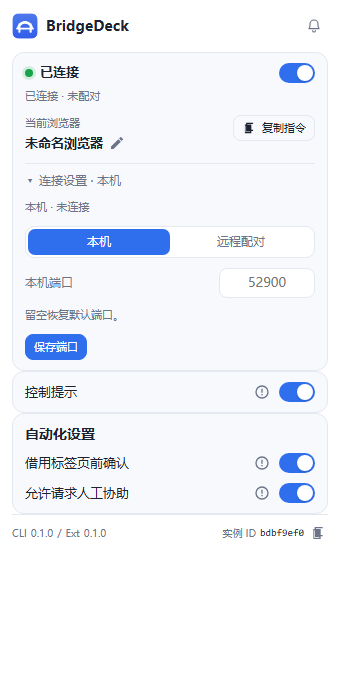

# BridgeDeck

<p align="center">
  
</p>

<p align="center">
  <strong>你的 Agent，你的浏览器，一条连接。</strong><br />
  把已经登录的浏览器变成一个可被 Agent 操作的 workspace。
</p>

BridgeDeck 把本机 Chromium 浏览器接到 Agent：读取页面、点击、填写、拖拽、截图、录制、调试，并把证据留在本机。任务在独立的 Agent Window 中运行；需要时可以借用已有标签页，结束后归还。

## 能做什么

| 目标 | BridgeDeck 提供 |
| --- | --- |
| 在已登录的页面里工作 | 复用浏览器登录态，读取文档、搜索内网、完成网页流程。 |
| 把指令变成浏览器动作 | VOM/AX 引用、点击、填写、选择、拖拽、滚轮、上传/下载、可信输入。 |
| 保持人在回路 | 共享控制、人工输入检测、暂停/交回、借用标签页确认。 |
| 取走网页数据 | 表格/列表提取为 JSON/CSV，列名、来源、合并单元格、覆盖范围明确。 |
| 定位失败证据 | 请求、响应体、控制台、页面变化、性能、重复请求、规则与重放。 |
| 留下可回看的记录 | 操作审计、操作录制、Trace v3、任务视频 MP4。 |
| 等页面就绪再继续 | `wait-for-element`、`wait-for-navigation`、`--settle`。 |
| 复用已观察结果 | `observe --save-full` 后用 `view` 搜索，不再抓一次页面。 |
| 多浏览器/多任务 | 浏览器实例命名、session 绑定、Agent Window、标签页移动。 |
| 给 Agent 工具接口 | CLI、MCP server、DSH 插件三套调用面。 |

## 快速开始

### 1. 启动与本机自检

```powershell
node cli/bridge.mjs doctor
node cli/bridge.mjs status
```

`bridge` 会在首次使用时自动拉起本机 daemon。

### 2. 加载扩展

1. 打开浏览器的扩展管理页。
2. 开启开发者模式。
3. 选择“加载已解压的扩展”，指向 `extension/`。
4. 如使用无痕窗口，在扩展详情页允许 InPrivate。

### 3. 跑第一个任务

```powershell
node cli/bridge.mjs session start
node cli/bridge.mjs navigate https://example.com
node cli/bridge.mjs observe
node cli/bridge.mjs click @e3
node cli/bridge.mjs screenshot --out shot.png
```

只有一个 session 时可省略 `--session`；多个 session 时必须显式指定。

## 常用命令

```powershell
node cli/bridge.mjs status
node cli/bridge.mjs session start --browser <实例名>
node cli/bridge.mjs tab list
node cli/bridge.mjs observe --vom --ax
node cli/bridge.mjs screenshot --out shot.png
node cli/bridge.mjs screenshot --mode auto --out page.png
node cli/bridge.mjs record start
node cli/bridge.mjs video start --duration 60s --quality high
node cli/bridge.mjs debug start
node cli/bridge.mjs debug requests
node cli/bridge.mjs debug archive --output debug.json
node cli/bridge.mjs audit list --limit 20
node mcp/server.mjs
```

完整参数以 `node cli/bridge.mjs --help` 为准。

## Agent 接入

| 方式 | 入口 |
| --- | --- |
| CLI | `node cli/bridge.mjs` |
| MCP | `node mcp/server.mjs`，49 个工具 |
| DSH 插件 | `dsh-plugin/`，34 个工具 |
| 内嵌技能 | `node cli/bridge.mjs install-skill --embedded` |

## 弹窗


弹窗包含：

- 连接状态、当前浏览器、复制指令、连接设置。
- 控制提示与自动化设置。
- 当前任务列表。
- 快捷功能：操作审计、长截图、视频录制、网站调试、操作录制，全部是内嵌面板；完整功能页仍保留。

## 文档

| 文档 | 内容 |
| --- | --- |
| [架构](docs/architecture.md) | 进程、扩展、会话与数据流 |
| [协议](docs/PROTOCOL.md) | CLI/daemon/扩展消息与帧格式 |
| [本地配对](docs/local-pairing.md) | 配对链接、凭据、严格模式 |
| [长截图](docs/long-screenshot.md) | 自动/手动/可见区域与拼接 |
| [视频录制](docs/video-recording.md) | MP4 分片、恢复、保存与清理 |
| [网站调试](docs/website-debugging.md) | 请求、控制台、证据、规则、重放 |
| [操作审计](docs/operation-audit.md) | 审计开关、任务列表、导出 |
| [MCP](docs/mcp.md) | MCP server 与工具面 |
| [安全](docs/security.md) | 本机边界、凭据、隐私 |
| [Windows 签名](docs/windows-signing.md) | 自签、时间戳与安装器 |
| [排障](docs/troubleshooting.md) | 常见失败与排查顺序 |
| [内部验证](docs/README.md#内部验证) | 对照覆盖、测试、交付清单 |

## 验证

```powershell
node --test tests/unit/*.test.mjs
node tests/cli/selftest.mjs
node tests/plugin/selftest.mjs
node tests/mcp/selftest.mjs
node tools/content-browser-selftest.mjs
node tools/overlay-browser-selftest.mjs
node tools/cooperation-trusted-input-selftest.mjs
node tools/e2e.mjs
node tools/release.mjs --check
```

最近结果：单测 **804/804**、E2E **131/131**、CLI **139/139**、插件 **21/21**、MCP **9/9**、配对 **10/10**、TLS **8/8**、内容/浮层/可信输入浏览器自测各 **1/1**。

## 构建与签名

```powershell
node tools/build-setup-exe.mjs
powershell -NoProfile -ExecutionPolicy Bypass -File .\tools\sign-windows.ps1 `
  -File .\dist\BridgeDeckSetup-0.1.1.exe `
  -Pfx .\dist\signing\BridgeDeck-selfsigned.pfx `
  -Password 'BridgeDeck-SelfSigned-2026!' `
  -TimestampUrl 'http://timestamp.digicert.com'
```

- 安装器：`dist/BridgeDeckSetup-0.1.1.exe`
- 自签证书不受系统信任，Windows 会显示未知发布者。
- 时间戳由公共时间戳服务提供。

## 目录

```text
cli/            CLI 入口
daemon/         本机 WebSocket daemon
extension/      MV3 扩展
extension/src/  逐模块 JS 镜像
lib/            共享库
mcp/            MCP server
dsh-plugin/     DSH 宿主插件
skill/          内嵌 Agent 技能
tests/          单测与调用方自测
tools/          E2E、构建、签名、发布校验
docs/           用户文档与内部验证记录
```

## 安全边界

- 默认只监听本机；远程连接必须显式开启并使用 WSS/配对 token。
- 本机未配对连接可用，但会显示身份警告；严格模式可关闭该回退。
- 凭据只保存在本机，不进入日志、截图或导出的证据。
- 审计、调试证据、视频与长截图都落在本机。

## License

MIT
