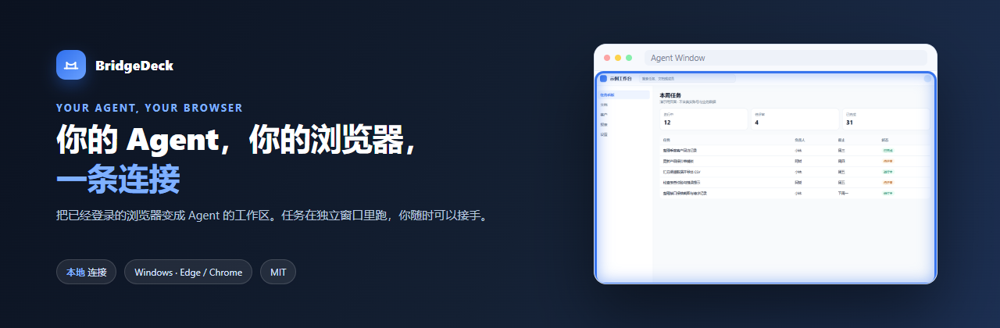
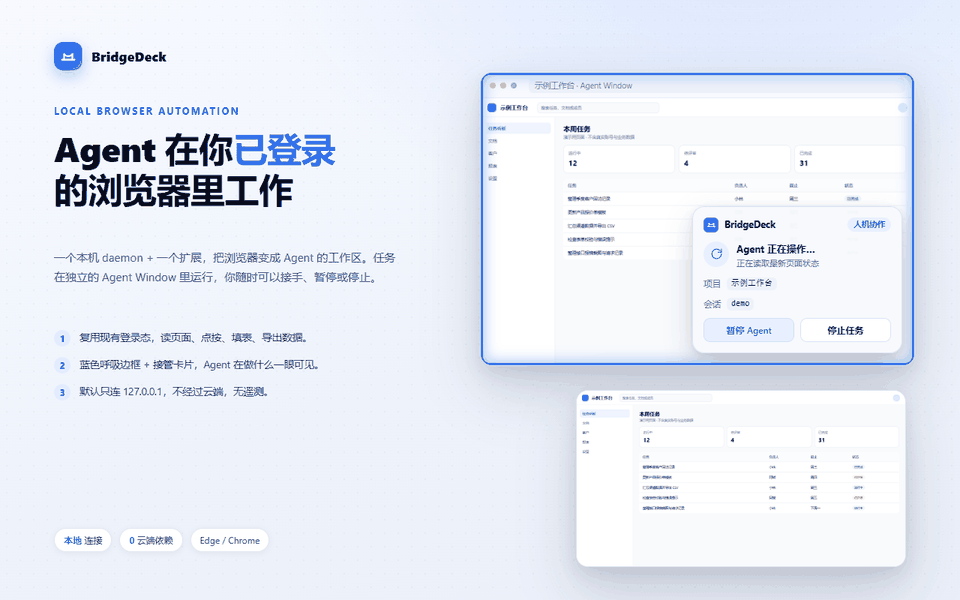

# BridgeDeck

<p align="center">
  
</p>

<p align="center">
  <strong>你的 Agent，你的浏览器，一条连接。</strong><br />
  把已经登录的浏览器变成 Agent 的工作区。
</p>

<p align="center">
  <a href="https://microsoftedge.microsoft.com/addons/detail/ieflpefpmlmmlfgmpfakaglhgmcbcnig"></a>
  <a href="https://github.com/iorl566/bridgedeck/releases/latest"></a>
  <a href="LICENSE"></a>
  
</p>

<p align="center">
  <a href="#看看实际效果">看看实际效果</a> ·
  <a href="#能做什么">功能</a> ·
  <a href="#安装">安装</a> ·
  <a href="#第一个任务">第一个任务</a> ·
  <a href="#浏览器控制与隐私">隐私</a> ·
  <a href="#文档导航">文档</a> ·
  <a href="docs/releases/0.1.2.md">更新日志</a>
</p>

**BridgeDeck 把你的 AI Agent 连接到 Chrome 或 Microsoft Edge，直接使用你已有的登录状态。** 交给它读取、点击、填表或排查问题；任务在独立的 **Agent Window** 中运行，需要时由你接手。已有标签页需要显式借用，任务结束后归还。默认只连接本机 daemon，不经过云端。

## 看看实际效果

<p align="center">
  
</p>

<p align="center">
  <sub>弹窗 → 接管浮层（蓝色呼吸边框 + 卡片）→ 快捷功能，全部是真实界面。</sub>
</p>

## 用你熟悉的 Agent

BridgeDeck 不绑定模型，也不要求换 Agent。只要能调用本地命令，就能通过同一个 `bridge` CLI 使用：

| 接入方式 | 入口 | 适合 |
| --- | --- | --- |
| **CLI** | `bridge` / `node cli/bridge.mjs` | Codex、Claude Code、Cursor 等能跑 Shell 的 Agent |
| **MCP** | `node mcp/server.mjs`（49 个工具） | 支持 MCP 的客户端 |
| **DSH 插件** | `dsh-plugin/`（34 个工具） | DeepSeek Harness，带任务预览与截图结果 |
| **Node/Python SDK** | `import { connect } from 'browser-bridge/sdk'` / `sdk/python/browser_bridge.py` | 写 Node/TypeScript 或 Python 脚本、集成测试 |
| **内嵌技能** | `bridge install-skill` | 支持 skill 的宿主，一条命令装上使用说明 |

## 能做什么

| 你想完成的事 | BridgeDeck 如何帮忙 |
| --- | --- |
| **用已有账号，做网站任务** | 复用浏览器登录态，读取文档、搜索内部网站，完成需要登录的网页流程。 |
| **一句指令，落实到操作** | VOM/AX 引用、点击、填写、选择、拖拽、滚轮、上传下载、可信输入；截取可见区域或整页。[能力矩阵](docs/FUNCTION-MATRIX.md) |
| **Agent 操作，你来掌控** | 共享控制、人工输入检测、暂停/交回、借用标签页确认；任务在独立窗口里可见运行。[接管浮层](#浏览器控制与隐私) |
| **网页表格，导出即用** | 表格/列表提取为 JSON/CSV，保留列名、页面/iframe 来源、合并单元格与覆盖范围。[结构化提取](docs/architecture.md) |
| **操作出错，找到线索** | 关联操作、请求、响应正文、控制台与页面变化，检查性能与疑似重复请求，用规则或重放验证。[网站调试](docs/website-debugging.md) |
| **录下过程，随时回看** | 把一个已授权的任务标签页录制为无声 MP4，在扩展里预览、保存或删除。[任务视频](docs/video-recording.md) |
| **整页留档** | 自动滚动、手动拼接、仅可见区域三种长截图模式；无需 Agent 也能用。[长截图](docs/long-screenshot.md) |
| **页面就绪，再做下一步** | `wait-for-element`、`wait-for-navigation`、`--settle`，避免"点太早"。[排障](docs/troubleshooting.md) |
| **已经观察，按需复用** | `observe --save-full` 后用 `view` 搜索历史观察，不再重新抓页面。[架构与数据流](docs/architecture.md) |
| **浏览器与账号，选对再开工** | 浏览器实例命名、session 绑定、标签页移动；也可以让服务器上的 Agent 连接本机浏览器。[本地配对](docs/local-pairing.md) |
| **任务结束，记录可查** | 操作审计默认关闭，开启后可按任务回看每一步。[操作审计](docs/operation-audit.md) |

## 安装

BridgeDeck 由三部分组成：**浏览器扩展 + 本机 daemon + CLI**。扩展负责操作页面，daemon 与 CLI 负责把能力交给 Agent。

### 方案 A：商店一键安装（推荐）

在 Microsoft Edge 加载项商店安装 **BridgeDeck**：

**[安装 Edge 扩展](https://microsoftedge.microsoft.com/addons/detail/ieflpefpmlmmlfgmpfakaglhgmcbcnig)**

扩展装好后打开弹窗，确认显示 **已连接**。daemon 会在第一次执行 `bridge` 命令时自动拉起。

### 方案 B：一行命令安装（Windows）

```powershell
irm https://raw.githubusercontent.com/iorl566/bridgedeck/main/install-online.ps1 | iex
```

脚本会查询最新发布包、安装到 `%LOCALAPPDATA%\BridgeDeck`、生成 `bridge` 命令并自检；需要自定义目录时：

```powershell
.\install-online.ps1 -Dest D:\Apps\BridgeDeck -AddToPath
```

也可以从 [Releases](https://github.com/iorl566/bridgedeck/releases/latest) 手动下载 `BridgeDeckSetup-0.1.2.exe` 或 `BridgeDeck-cli-bundle-0.1.2.zip`。安装器目前是自签名，Windows 会显示"未知发布者"；签名与校验方式见 [Windows 签名](docs/windows-signing.md)。

<details>
<summary><b>方案 C：从源码加载（开发用）</b></summary>

1. 克隆仓库并确认 Node.js 22+。
2. 打开 `edge://extensions`，开启"开发者模式"。
3. 选择"加载已解压的扩展"，指向 `extension/`。
4. 在扩展详情页允许无痕模式（如需要 InPrivate）。
5. 运行 `node cli/bridge.mjs doctor` 自检，再执行 `node cli/bridge.mjs status`。

</details>

### 方案 D：让 Agent 自己装

把下面这句话发给你的 Agent：

```text
Set up BridgeDeck on this machine by following
https://raw.githubusercontent.com/iorl566/bridgedeck/main/AGENT_INSTALL.md
```

Agent 会按指南把 CLI 与 daemon 装到用户目录（`%LOCALAPPDATA%\BridgeDeck`，可用 `-Dest` 改），再引导你装扩展或自行解压加载；不会写死盘符，也不会动你的其它文件。安装与验证步骤见 [AGENT_INSTALL.md](AGENT_INSTALL.md)。

## 第一个任务

装好并显示"已连接"后，对 Agent 说：

```text
用 BridgeDeck 打开 https://example.com，总结页面内容，完成后结束浏览器会话。
```

Agent 会在独立的 Agent Window 里打开页面、读取内容、返回总结，然后结束任务。

<details>
<summary><b>直接试用 CLI</b></summary>

```powershell
node cli/bridge.mjs session start --json    # 记下 session_id
node cli/bridge.mjs navigate https://example.com --session <id>
node cli/bridge.mjs observe --session <id>
node cli/bridge.mjs screenshot --out example.png --session <id>
node cli/bridge.mjs session stop <id>
```

只有一个 session 时可省略 `--session`。完成或失败后都应结束会话；借用的标签页会归还。

</details>

## 浏览器控制与隐私

**Agent Window 共享所选浏览器的登录态，它不是独立账号，也不是安全沙盒。** Agent 可以使用已登录网站授予的权限执行操作，请选择你信任的 Agent 和任务。

扩展提供三个开关，默认全部开启：

| 设置 | 控制什么 |
| --- | --- |
| **控制提示** | 显示接管卡片与蓝色呼吸边框。关闭后立即移除所有页面上的浮层，再打开立即恢复。 |
| **借用标签页前确认** | Agent 接管你已有的标签页之前先请求确认。关闭后允许免确认借用；该开关只能由你在扩展弹窗修改。 |
| **允许请求人工协助** | 允许 Agent 请你处理登录、验证或其他需要本人参与的步骤。关闭后请求会直接被拒绝。 |

BridgeDeck 没有必须使用的云服务，也不收集产品遥测。扩展不会自行调用 AI 提供商；自动化结果只交给本机 daemon 和你选择的 Agent。

| 可选记录 | 保存位置 | 需要知道的事 |
| --- | --- | --- |
| **网站调试** | 本机浏览器配置 | 保留请求、响应正文、控制台与页面变化；可能包含敏感信息，导出前请检查。 |
| **操作审计** | daemon 所在主机的 `~/.browser-bridge/audit`（或 `BB_HOME`） | 默认关闭；只记录任务与操作元数据。 |
| **任务视频** | 本机浏览器配置；导出副本在指定位置 | 主动开启后录制单个已授权标签页，无声 MP4；临时文件会被清理。 |
| **长截图 / 截图** | 你指定的输出路径 | 只在执行命令时写入，不自动上传。 |

调试与视频功能都支持导出和删除；脱敏只能覆盖已知敏感字段，不能保证完全移除敏感信息。视频画面不会自动脱敏，分享前请检查可见内容。

## 已知行为与限制

这些是设计如此、不是缺陷：

- **窗口路由**：外部链接或手动新建的标签落进 Agent Window 时，会被移回你最近使用的普通窗口；没有普通窗口时会新建一个。移动发生在创建之后，标签可能短暂出现再被移走。
- **标签移出即结束**：把受控标签拖出原 Agent Window 会结束整个会话，页面保留在原地，控制标识移除；拖回去不会自动恢复任务。
- **弹窗取焦**：网页打开原生弹窗时，Chrome 仍可能激活窗口。Chrome 公开扩展 API 无法保证完全没有瞬时激活。
- **截图与浮层**：CDP 截图不包含 Shadow DOM 里的接管浮层；需要看浮层时用系统截图或直接看窗口。
- **未配对连接**：本机未配对仍可使用，但弹窗会显示身份未验证；严格模式可关闭该回退。

## 更多用法

- **整页截图**：`bridge screenshot --mode auto --out page.png`，或在弹窗里打开"长截图"。[长截图](docs/long-screenshot.md)
- **指定浏览器**：`bridge browsers` 查看实例，`bridge session start --browser "工作账号"` 绑定。[本地配对](docs/local-pairing.md)
- **多 Agent 并行**：`session start --agent-name … --project …`，之后用 `--session-scope <名字>` 或 `BB_SESSION` 选会话。[会话作用域](docs/scope.md)
- **远程连接**：扩展通过 WSS 连接服务器上的 daemon，本机无需开入站端口。[本地配对](docs/local-pairing.md)
- **任务视频**：`bridge video start --duration 60s --quality high`。[视频录制](docs/video-recording.md)
- **操作审计**：`bridge audit list --limit 20`。[操作审计](docs/operation-audit.md)
- **网站调试**：`bridge debug start` → `debug requests` → `debug archive --output debug.json`。[网站调试](docs/website-debugging.md)
- **Trace 可视化**：`bridge record export --out trace` → `bridge trace view trace/trace.json`。[Trace Viewer](docs/trace-viewer.md)
- **MCP / 插件**：`node mcp/server.mjs`、`dsh-plugin/`。[MCP](docs/mcp.md)
- **Node/Python SDK**：`import { connect } from 'browser-bridge/sdk'` / `from browser_bridge import connect`，Playwright 风格的 `newPage()` / `page.click()`。[SDK](docs/sdk.md)

## 升级与版本兼容

CLI、daemon、扩展、DSH 插件应保持同一版本使用新功能。

1. 先更新 CLI（替换 `bin/bridge.cmd` 或重新运行安装包）；
2. 重启 daemon：`bridge daemon restart`；
3. 再更新扩展（商店更新，或重新加载解压目录）；
4. 最后更新 DSH 插件并重启 profile。

商店版本会因审核滞后于仓库；本 README 描述的是当前仓库能力。版本变化见 [更新日志](docs/releases/0.1.2.md) 与 [Releases](https://github.com/iorl566/bridgedeck/releases)。

## 文档导航

| 你想做什么 | 文档 |
| --- | --- |
| 让 Agent 自动安装 | [Agent 安装指南](AGENT_INSTALL.md) |
| 了解进程、扩展与数据流 | [架构](docs/architecture.md) |
| 排查请求/接口问题 | [网站调试](docs/website-debugging.md) |
| 截取长页面 | [长截图](docs/long-screenshot.md) |
| 录制并保存任务视频 | [视频录制](docs/video-recording.md) |
| 回看任务操作记录 | [操作审计](docs/operation-audit.md) |
| 回放 Trace 步骤 | [Trace Viewer](docs/trace-viewer.md) |
| 检查文字/按钮对比度 | [VOM 颜色对比度](docs/visual-contrast.md) |
| 查看方法参数 schema | [协议 schema](docs/schema.md) |
| 连接服务器上的 Agent | [本地配对](docs/local-pairing.md) |
| 多会话/多 Agent 选会话 | [会话作用域](docs/scope.md) |
| 调试器何时挂载/分离 | [调试器生命周期](docs/debugger-lifecycle.md) |
| 了解预写意图账本 | [意图账本](docs/intent-ledger.md) |
| 减少大页面重复观察 | [观察增量](docs/observation-delta.md) |
| 在 MCP 客户端里使用 | [MCP](docs/mcp.md) |
| 在 Node/TypeScript 里调用 | [Node/Python SDK](docs/sdk.md) |
| 在 Python 里调用 | [Node/Python SDK](docs/sdk.md) |
| 了解协议与消息 | [协议](docs/PROTOCOL.md) |
| 遇到问题先看 | [排障](docs/troubleshooting.md) |
| 安全边界与凭据 | [安全](docs/security.md) |
| 构建与自签名 | [Windows 签名](docs/windows-signing.md) |

## 面向开发者

```powershell
node --test tests/unit/*.test.mjs   # 单元测试
node tests/cli/selftest.mjs         # CLI 全链路
node tests/mcp/selftest.mjs         # MCP
node tools/e2e.mjs                  # 端到端（默认不改 docs/assets；BB_E2E_SYNC_DOCS=1 时同步文档截图）
node tools/release.mjs --check      # 发布产物一致性
```

最近结果：单测 **898/898**、CLI **143/143**、MCP **10/10**、DSH 插件 **24/24**、Python SDK **7/7**、protocol-check 全绿（`handlersNotInProtocol=[]`、`schemaMissing=[]`、`mcpMethodsNotInProtocol=[]`）、真实 Edge E2E **131/133 通过（2 项因借用确认安全策略跳过）**。

```text
cli/            CLI 入口
daemon/         本机 WebSocket daemon
extension/      MV3 扩展（src/ 为逐模块镜像）
lib/            共享库
mcp/            MCP server
sdk/            Node SDK（Playwright 风格薄封装）
dsh-plugin/     DSH 宿主插件
skill/          内嵌 Agent 技能
tests/          单测与调用方自测
tools/          E2E、构建、签名、发布校验
docs/           用户文档与发布记录
```

欢迎通过 [Issues](https://github.com/iorl566/bridgedeck/issues) 报告问题或提出建议；附浏览器证据前请先移除敏感数据。提交较大改动前建议先跑上面这组测试。

## 多语言与贡献

界面目前提供中文与英文；扩展文案在 `extension/ui/i18n.js`，文档以中文为主。欢迎补充翻译、修正文档或提交聚焦的 PR。

## License

[MIT](LICENSE)
