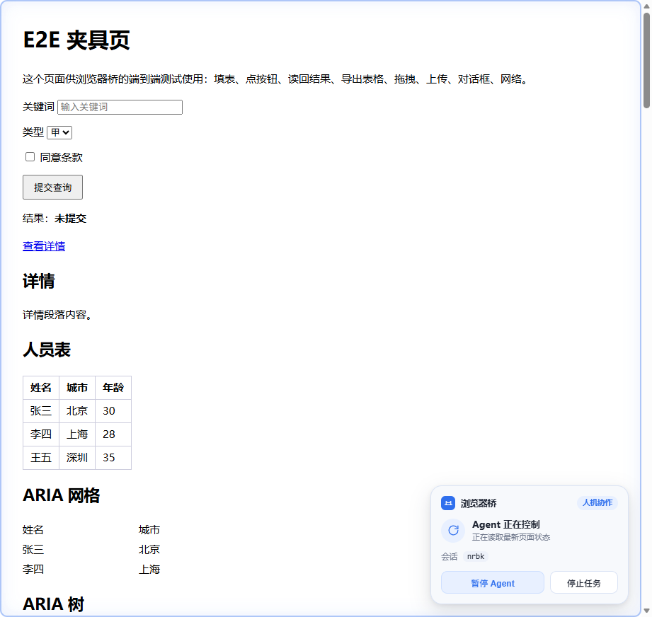
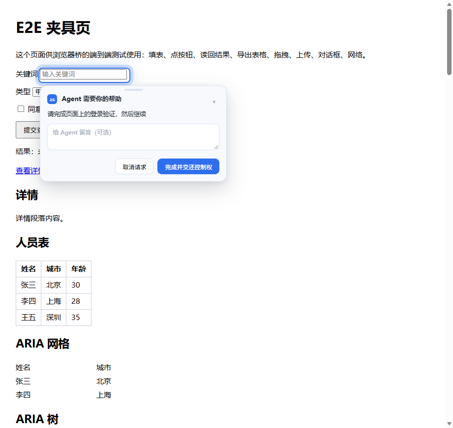
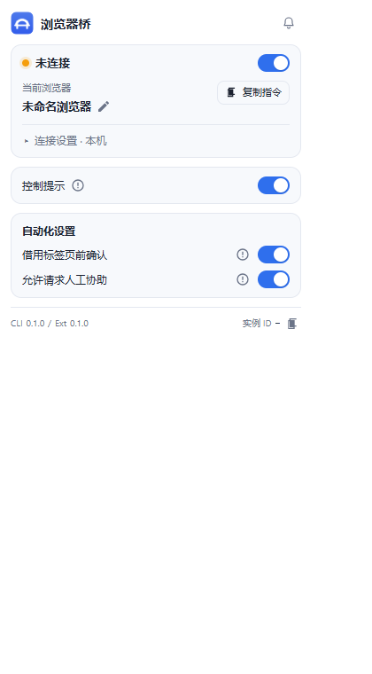
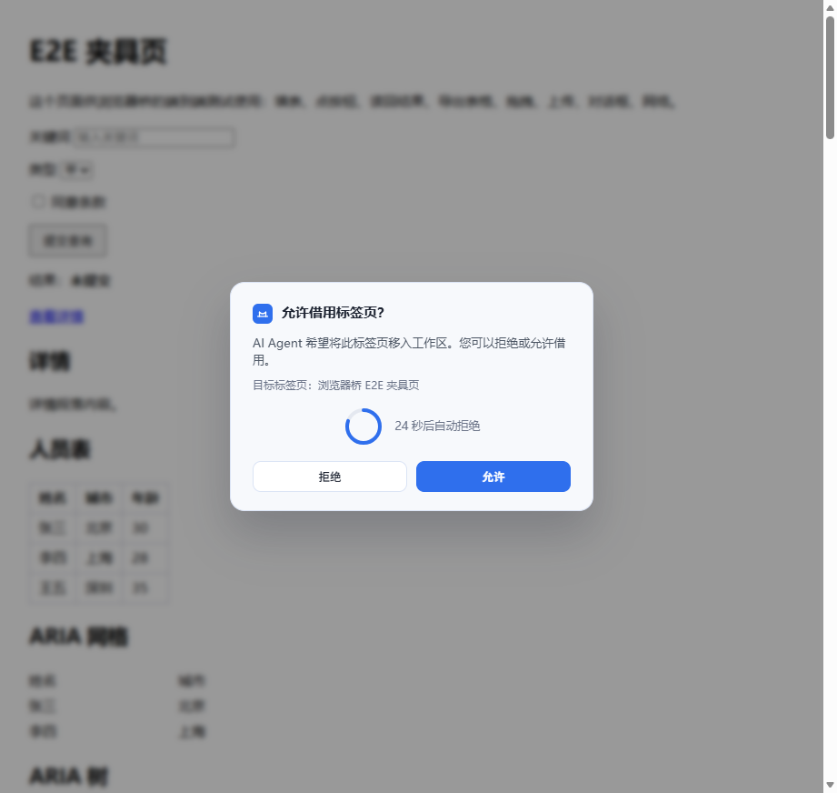

# 扩展 UI：结构/功能对齐 参考实现，视觉自有

## 原则

- **结构、交互、信息架构 100% 对齐** 参考实现 0.4.2（同一套区块、同一套操作路径、同样的状态语义）。
- **视觉做成我们自己的**：沿用BridgeDeck既有配色与品牌（蓝色主色 #2f6fed、浅灰卡片、圆角 10–12px、系统字体），
  不使用对方的 logo、图标与品牌元素。
- 不复制对方的编译样式；`extension/ui/popup.css` 为本项目自写。

## 弹窗（popup）

结构（与参考实现一致）：

1. 品牌头：logo + 标题 + 快捷功能入口
2. 连接卡片：状态点/文案 + 连接开关；当前浏览器 + 重命名 + 复制指令；
   “连接设置 · 本机/远程”折叠区（端口、远程配对）
3. 控制提示卡（开关 + 说明气泡）
4. 自动化设置卡（借用前确认、允许人工协助 + 说明气泡）
5. 当前任务卡（有会话/调试/录制任务时出现）
6. 页脚：CLI/Ext 版本 + 实例 ID（可复制）
7. 快捷功能视图（5 个入口）+ 各面板视图

截图：[our-popup-new.png](assets/our-popup-new.png)、[our-features.png](assets/our-features.png)

已完成：主视图全部区块、快捷功能列表、面板框架、开关/折叠/复制/重命名/端口/配对交互。
待补齐：五个面板的**内联**操作（视频开始/停止、调试采集状态、长截图预览、录制、审计列表），
以及连接状态徽标（远程/版本偏差）与暗色主题细节。

## Agent 接管浮层

- `extension/src/takeover.js`：Shadow DOM，全屏高亮边框（蓝色呼吸）+ 右下角卡片
  （品牌行、状态标题、说明、收回控制/收起、最小化）。
- 视觉已按我们的蓝色配色调整；截图（结构参考）：[our-takeover.png](assets/our-takeover.png)
- 注入点：`window.ensureAgent`、`tab.borrow`、导航完成后的 `refreshTakeoverForTab`。
- 已修复：`navigate` 完成后直接注入；真实会话导航后浮层自动出现。
- 交互已打通：收起为小胶囊、点击胶囊展开、卡片可拖动并记忆位置、**收回控制**会通知 daemon 停掉对应 session（日志与 session 列表已验证）。
- 仅在 http/https 页面注入，避免扩展页/错误页出现浮层。
- 旧版深色“控制提示”胶囊已停用（只保留清理逻辑），避免与新卡片叠加产生黑色块。
- 卡片改为不透明底色 + 柔和多层阴影（去掉 backdrop-filter），不再出现黑色阴影。

## 视觉差异（自有品牌）

| 项 | 参考实现 | BridgeDeck |
| --- | --- | --- |
| 主色 | 橙色 #f97316 | 蓝色 #2f6fed |
| 品牌 | 参考实现默认品牌元素（不使用） | BridgeDeck图标/四宫格入口 |
| 字体/圆角 | 参考主题 | 系统字体、10–12px 圆角 |
| 结构 | 参考 | 同构（同区块/同操作路径） |

## 下一步

1. 修复接管浮层自动注入并加回归（真实会话 → 页面出现浮层）。
2. 五个面板内联化：对照 video-panel/debug-panel/long-screenshot/record/audit 的结构实现。
3. 子页（audit/debug/longshot/video/record）按同结构重做视觉。
4. 回归：E2E 弹窗截图/自测 + 手动截图逐屏对比。

## 2026-11-10 逐屏对齐

- 弹窗/快捷功能/五个子面板按 参考实现 结构重排，文案逐字核对。
- 悬浮说明改为右对齐展开，修复右侧气泡被弹窗边缘裁切。
- 快捷功能图标改为线性图标；主界面右上角改为 2×2 线性图标。
- 新增视频录制页（修复原“打开录制页”链接 404）；调试页/审计页按对方结构重排。

- 操作审计改为扩展侧任务审计（默认关闭，可在弹窗开关；审计页支持清空）。
- 长截图页改为“预览优先”：有最近一次截图则展示，否则显示“截图暂不可用”。

- 快捷功能/录制页/操作录制历史互相打通，不再有孤立页面；设置页仍由浏览器扩展选项入口进入。

- 接管浮层按 参考实现 结构重做：图标+名称+“人机协作”胶囊、状态行（Agent 正在控制/已暂停）、会话 ID、暂停/交给 Agent、停止任务；保留蓝色品牌色。
- 新增会话暂停能力（`bridge session pause/resume`，暂停后动作返回 E_SESSION_PAUSED）。

接管浮层：

- 弹窗右上入口改为协助铃铛（仍打开快捷功能，aria-label=快捷功能）。
- 人工协助卡片按 参考实现 重做：靠目标展示、拖动条、折叠、备注、取消请求/完成并交还控制权；协助期间隐藏接管卡片，完成后恢复。
  协助卡片：

弹窗右上协助铃铛：

- 接管卡片补齐 7 态文案、人操作/编辑检测（空闲 3 秒回退）、最小化胶囊、项目行。
- 新增页面内录制胶囊（计时/结束/拖动）。

借用确认模态（居中/倒计时环/自动拒绝）：

- 借用确认改为居中模态（倒计时环/自动拒绝）；弹窗当前任务接入调试采集；手动长截图增加页内浮层。

- 借阅确认居中模态、当前任务区块、页内手动长截图浮层、视频面板录制中状态、改名校验（会话中禁用/禁止实例 ID 形状）。

- 远程配对支持配对链接（url#token）一键解析，CLI pair create 输出链接。
