# 运行时 UI 对比：执行期间的浮层/提示（BridgeDeck vs 参考实现）

> 范围：Agent **执行期间**用户能看到的界面——接管控制条、借用确认、人工协助卡片、录制浮层、
> 长截图进度、视频状态、Toast/通知、页面标记等。
> 证据：两侧源码/i18n 键、`extension/src/overlay-*.js`、`record-overlay.js`、`manual-overlay.js`、
> 以及真实浏览器差分结果（borrow 的 UIA 确认、record/help 流程）。
> **截图状态（如实）**：本轮尝试的三条运行时截图路线均失败（见 §5），本文先给结构与行为对比，
> 不拿静态页或错误页冒充运行时截图。

## 1. 浮层清单与结构

| 运行时 UI | 参考实现（源码/i18n 证据） | 我们（源码证据） | 对比 |
| --- | --- | --- | --- |
| 接管/控制条 | `controlOverlay`：minimize/expand/project/session/holdController/resumeController/status/interrupt | `overlay-ui.js#installTakeover` + cooperation controller（toolbar/悬浮控制条） | 都有；参考实现文案更“产品化”（项目/会话/中断），我们控制项更细（passthrough/租约/hold） |
| 借用确认 | `borrowConfirmation`：title/body/targetTab/autoDeny 倒计时/deny/allow + 系统通知 notificationTitle/Body | `overlay-ui.js#borrowBanner` + `borrowToast` + `borrow-ui.js`（closed shadow 注入 + human-only 设置） | **行为差异**：参考实现确认条在可访问性树里（UIA 可点，差分里真实点过 `允许` 并成功借用）；我们 closed shadow + `borrowConfirm` human-only，UIA 不可达，只能真人点 |
| 人工协助卡片 | `helpRequest`：title/compactStatus/noteLabel/notePlaceholder/continue/cancel/collapse/expand/dragHandle + 通知 | `overlay-ui.js#helpOverlayFunc` + handoff/epoch；`a11y-dialog` 焦点管理 | 都有；参考实现含“给 Agent 留言/收起/拖拽”，我们含 handoff 语义 |
| 录制浮层 | `recordOverlay`：recording/finish；record start 打开 Agent Window 并阻塞 | `record-overlay.js#installRecordOverlay`（录制中提示 + 结束按钮）+ 录制页 | 都有；参考实现更强调“完成后给 Agent 的 trace 指令” |
| 长截图进度 | `longScreenshot`：phase(preparing/capturing/saving/complete/cancelled/error/paused) + 12 类错误 + preview/zoom/fit/pause/resume/finish | `longshot` 页面 + 注入进度浮层（`manual-overlay.js`、capture overlay） | 都有；参考实现把进度/错误文案矩阵写在 i18n，我们进度状态在页面里 |
| 视频状态 | `video`：state(starting/recording/finalizing/ready/failed) + reason(11 类) + 保留 24h + 面板 | `video` CLI/面板 + `record-overlay`/页面状态 | 都有；参考实现面板状态/原因更细 |
| Toast/通知 | 系统通知（notificationTitle/Body，借用/协助/升级） | `borrowToast`、页面 toast、`notifications` 权限（popup 通知） | 参考实现系统通知成体系；我们以页面内 Toast 为主 |
| 页面标记 | 目标高亮/操作标记 | `target-marker.js`（点击目标高亮）+ receipt/marker（`targetMarker: shown`） | 相当；我们回执证据更细 |
| 错误/提示 | i18n 错误矩阵 | `error-hints.js`（45KB，多语言错误提示 + 恢复动作） | 我们更细；参考实现与 UI 状态绑定更紧 |

## 2. 视觉与品牌（执行期）

| 维度 | 参考实现 | 我们 |
| --- | --- | --- |
| 主色 | 橙/暖白（品牌色） | **自有蓝**（#2f6fed→#1f4fd0）+ 品牌锁头；浮层用 `--bb-*` 主题 token |
| 形状/圆角 | 大圆角卡片、虚线空态、暖色状态 | 12–16px 圆角、蓝渐变、虚线空态（本轮统一） |
| 深色 | 有 dark token（本轮我们补了 `prefers-color-scheme` token） | 已补暗色 token；浮层继续用 token 兜底 |
| 动效 | 收起/展开/倒计时 | 倒计时/焦点陷阱/减少动效降级 |

## 3. 行为差异（执行期最关键的 3 条）

1. **借用确认的可自动化性**：参考实现确认条可被 UIA 点击（差分真实点过 `允许` 并借用成功）；
   我们 closed shadow + human-only 设置，**只能真人点**。安全取舍，不是缺陷，但自动化/无人值守场景体验不同。
2. **通知渠道**：参考实现借用/协助/升级会发 **系统通知**；我们主要是页面内 Toast/浮层 + popup。
3. **执行期引导文案**：参考实现把“给 Agent 的下一步提示/录制完成后如何交回 trace”写进浮层与面板
   （如 recordOverlay 文案、video prompt 模板），我们分散在页面/错误提示里。

## 4. 建议（执行期 UI 增强）

- **P0**：借用确认/协助卡片统一到 `ui/components` 的 dialog/banner 组件，但保留 closed-shadow + human-only
  安全策略；补“请真人点击”的明确提示与超时倒计时（参考实现有 autoDeny 倒计时，我们有超时但文案不够显眼）。
- **P1**：接管控制条品牌化（蓝色阶、项目/会话标题、中断按钮位置），与 popup 品牌锁头呼应。
- **P1**：录制/长截图/视频的**执行中指示器**统一：右上角蓝色状态 chip（录制中/截图中/录制视频中），
  并复用 `createSwitch/createButton` 组件。
- **P2**：系统通知补齐（借用/协助/升级），与参考实现对齐；通知文案复用 `error-hints` 风格。

## 5. 运行时截图：为什么还没有（与补救）

已尝试：
1. **真实触发 + CDP 截图**：起 daemon+扩展后触发 record/help/borrow，用 CDP 截页面——
   `--runtime` 模式两次运行均挂起（>10min，已在环境里终止；疑似 CLI 阻塞/后台子进程未退出）。
2. **测试 harness 页面**：`tests/browser/overlay-dom.html` 等是断言型 harness，截图时浮层已卸载/未挂载
   （产出为空白/PENDING 页，已删除，未冒充）。
3. **headless 直接加载扩展页**：扩展不加载（前述已记录）。

**确定可行的补救（下一轮实现）**：写一个专用 **runtime overlay 演示页**
`tools/ui-overlays.html?view=borrow|help|takeover|record|toast&hold=1`，直接 import
`extension/src/overlay-ui.js` 等函数并渲染后**保持不卸载**；用本地静态服务器 + headless Edge
`--virtual-time-budget` 截图。这与真实注入使用同一渲染函数、同一 theme token，能产出可对比的执行期截图；
再把截图纳入 `docs/ui-shots-runtime/` 与基线。

> 本文不伪造运行时截图；结构/行为结论均有源码与真实差分证据支撑。

## 6. 运行时浮层截图（已打通，2026-11-26 晚）

新增 `tools/ui-overlays.html`：直接 import 扩展**生产用**的浮层渲染函数（`overlay-ui.js` 的
borrowBanner/helpOverlayFunc/installTakeover、`record-overlay.js` 的 installRecordOverlay）与
`OVERLAY_THEME`，在本地静态页里按 `?view=` 渲染并保持不卸载；headless Edge + `--virtual-time-budget`
截图。这样拿到的是**真实执行期浮层**（同一渲染函数/主题 token），不是静态占位。

| 运行时 UI | 截图 |
| --- | --- |
| 借用确认（含 25s 倒计时、拒绝/允许） | 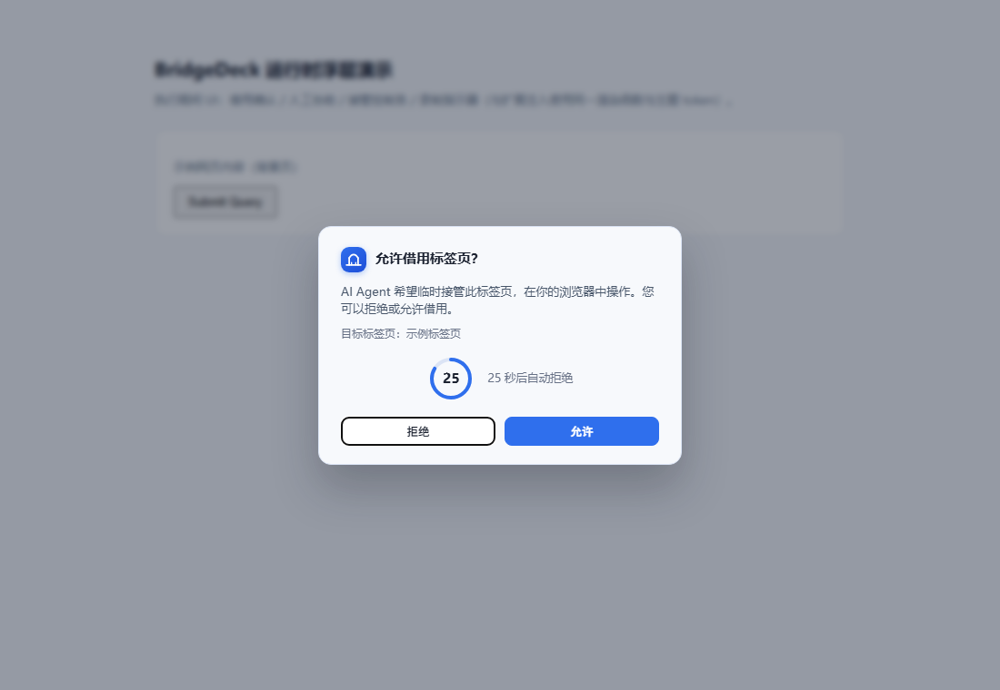 |
| 人工协助卡片（留言框、取消请求、完成并交还控制权） | 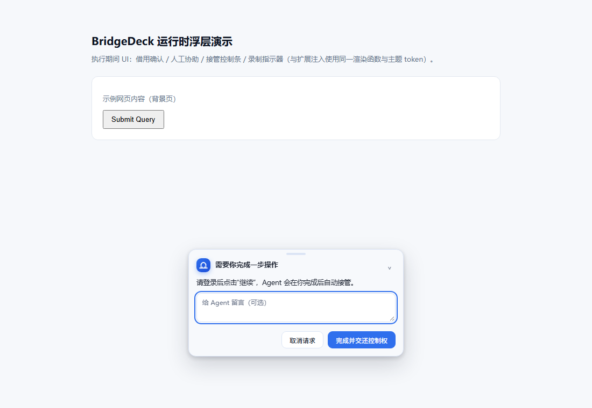 |
| 接管控制条（Agent 已就绪、项目/会话、暂停/停止任务） | 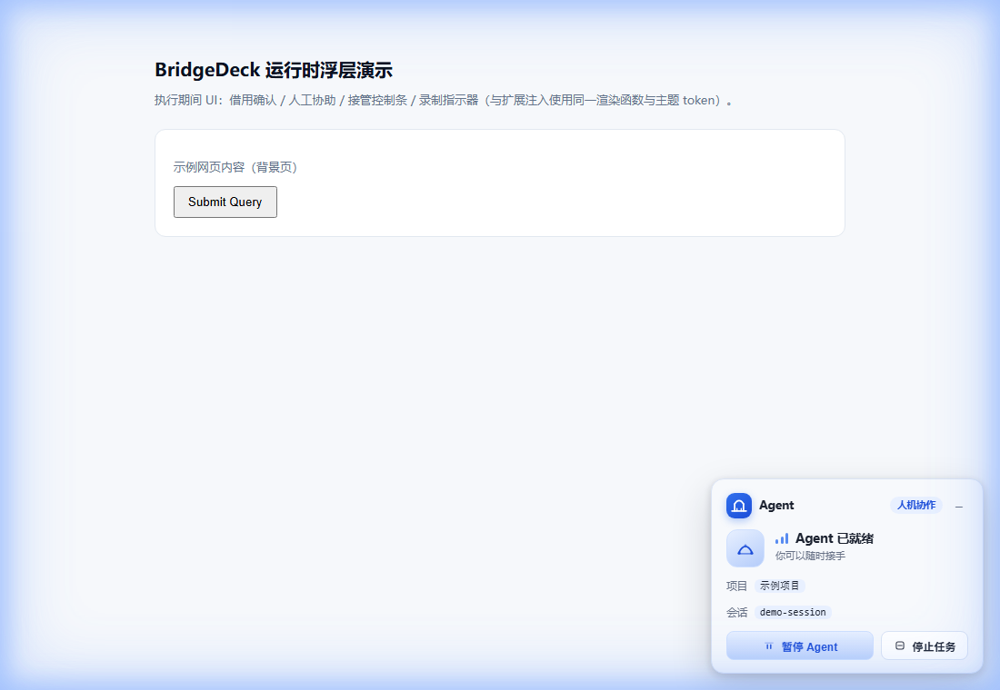 |
| 录制指示器（红点、计时、结束） | 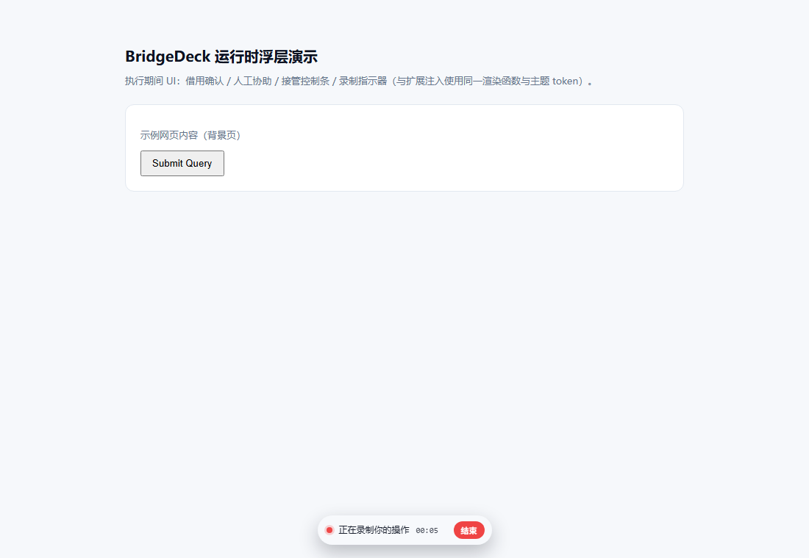 |

**视觉结论**：
- 我们的运行时浮层已经是**自有蓝品牌**：蓝色主按钮、品牌小 mark、圆角卡片、阴影统一；
- 借用确认有倒计时环 + “拒绝/允许”并列按钮，信息层级清晰；
- 协助卡片有留言输入 + 两个动作按钮，焦点环可见（a11y token）；
- 接管控制条在右下角，显示 Agent 状态/项目/会话与“暂停 Agent/停止任务”，比参考实现的 controlOverlay
  更强调“会话/项目”上下文；
- 与参考实现（橙/暖色 + 系统通知）相比：颜色不同是品牌选择；**参考实现的借用/协助会发系统通知**、
  文案更“柔和引导”，我们的按钮动作更明确。

**仍未截到的**：参考实现侧的运行时浮层（React 打包在 background bundle 内，需要真实触发才能渲染；
其 i18n 状态矩阵已在 §1 对比）。我们侧的帮助/接管/录制/借用已全部有图。

## 7. 参考实现（BSK 0.5.0）运行时浮层截图（已补齐）

新增 `tools/ui-bsk-runtime.mjs`：临时 BSK_HOME + `bsk daemon start --foreground` + 复制扩展 + 有头 Edge
（用户窗口先开 fixture 页）→ `bsk open` 建 Agent Window → 分别触发 borrow / request-help / record /
full-page screenshot，并用 CDP 对两个 fixture 页面（用户窗口 + Agent Window）截图。

| 运行时 UI | 我们 | 参考实现 |
| --- | --- | --- |
| 借用确认 |  | 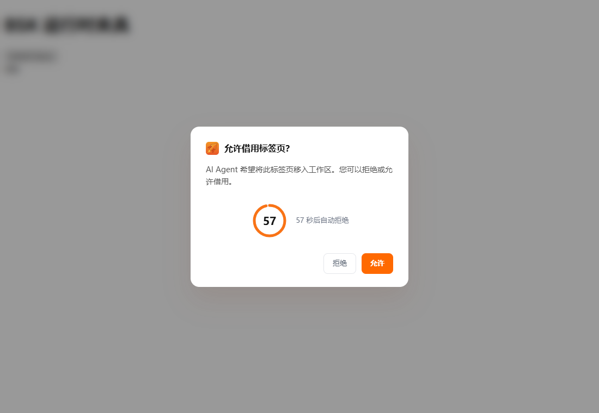 |
| 人工协助卡片 |  | 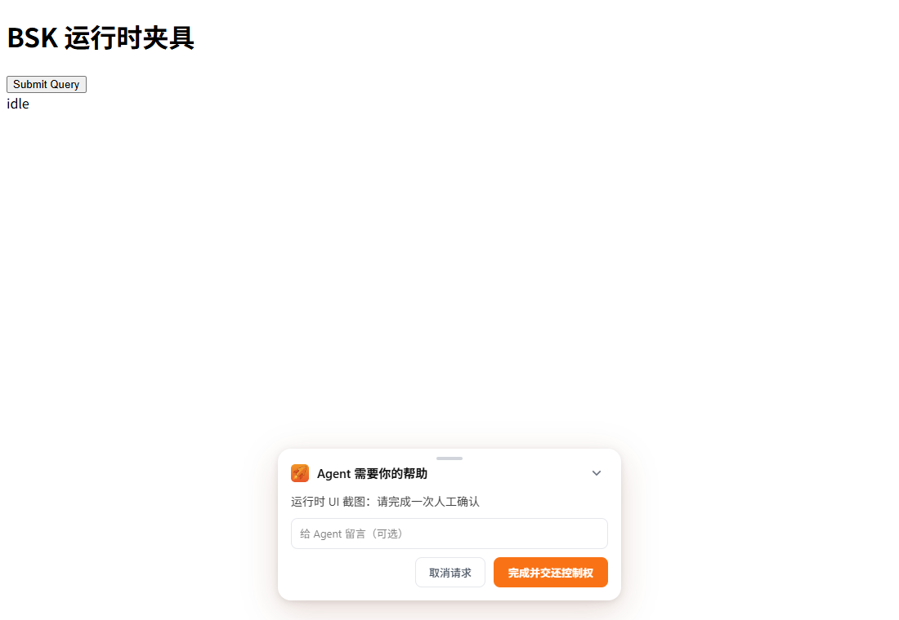 |
| 接管/控制条 |  | 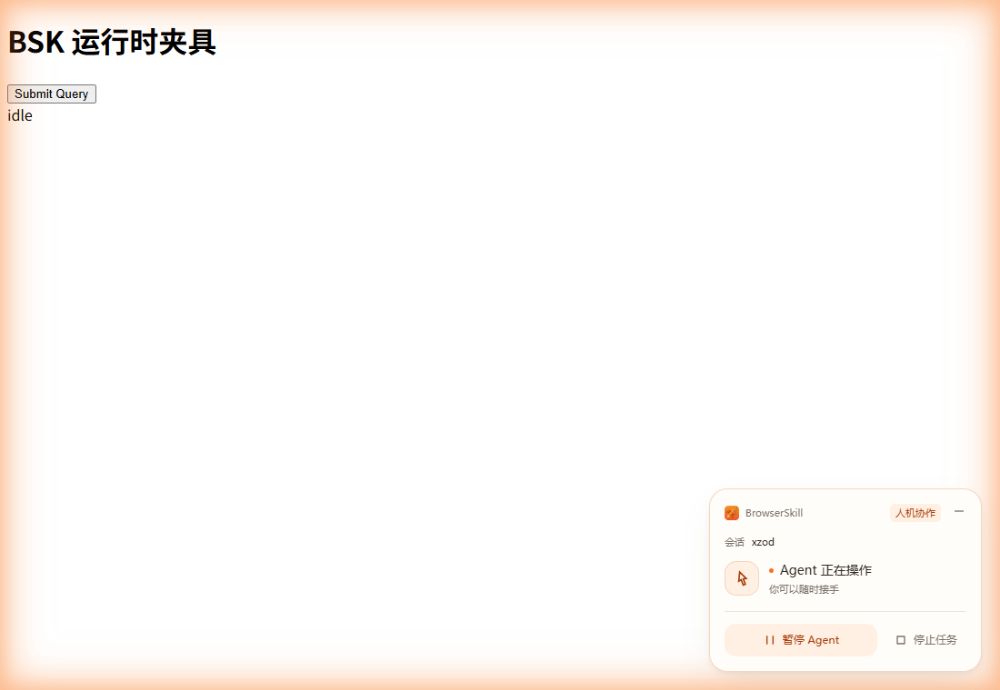 |
| 录制指示器 |  | 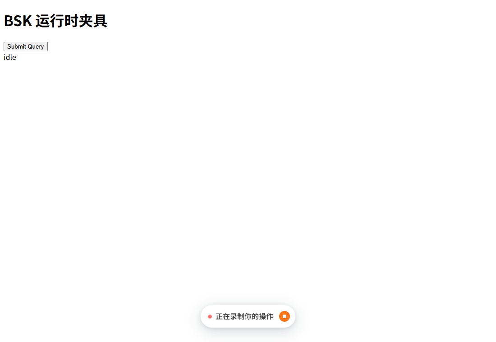 |

**逐项对比结论**

1. **借用确认**：结构几乎一致——标题 + 说明 + 目标页 + 倒计时环 + “拒绝/允许”。
   差异：我们蓝（25s 起倒计时、允许按钮实心蓝）；参考实现橙（57s 起倒计时、允许按钮实心橙）、
   标题“允许借用标签页?”、按钮顺序同为“拒绝在左/允许在右”。
2. **人工协助卡片**：都是底部悬浮卡 + 留言框 + 两个动作；我们“取消请求/完成并交还控制权”（蓝），
   参考实现同文案（橙）+ 卡片可收起（∧）与拖拽手柄；参考实现多了收起/展开状态。
3. **接管/控制条**：都是右下角控制条，显示品牌/会话/“Agent 正在操作（可随时接手）”/暂停/停止；
   我们额外显示“项目/会话”两行并带暂停图标，参考实现把“人机协作”做成状态 chip。
4. **录制指示器**：都是页面底部小药丸；我们显示计时（00:05）+“结束”按钮，参考实现仅“正在录制你的操作”+红点
   （结束走浮层/页面），我们的计时反馈更直接。
5. **视觉品牌**：参考实现橙/暖白一以贯之；我们蓝色一以贯之（与 popup/页面品牌锁头一致），无混用。

**限制**：参考实现的整页长截图进度浮层属于页面内 React 状态，本次截图未捕捉到 overlay（只拿到页面本身），
列为后续（可在截图命令执行窗口内更早/更频繁采样）。

## 8. 长截图进度 / 视频状态 / Toast 截图补齐（2026-11-26 晚）

新增 `extension/src/status-chip.js`：**统一执行期状态 chip**（kind=recording/capture/video），
复用 record-overlay 的视觉语言（药丸、状态点、计时、aria-live），支持 update/remove；
已通过 `record-overlay.js` 纳入运行时模块图，后续 video/longshot 可直接复用。

| 运行时 UI | 我们（demo 页用生产渲染函数） | 参考实现 |
| --- | --- | --- |
| 长截图进度 | 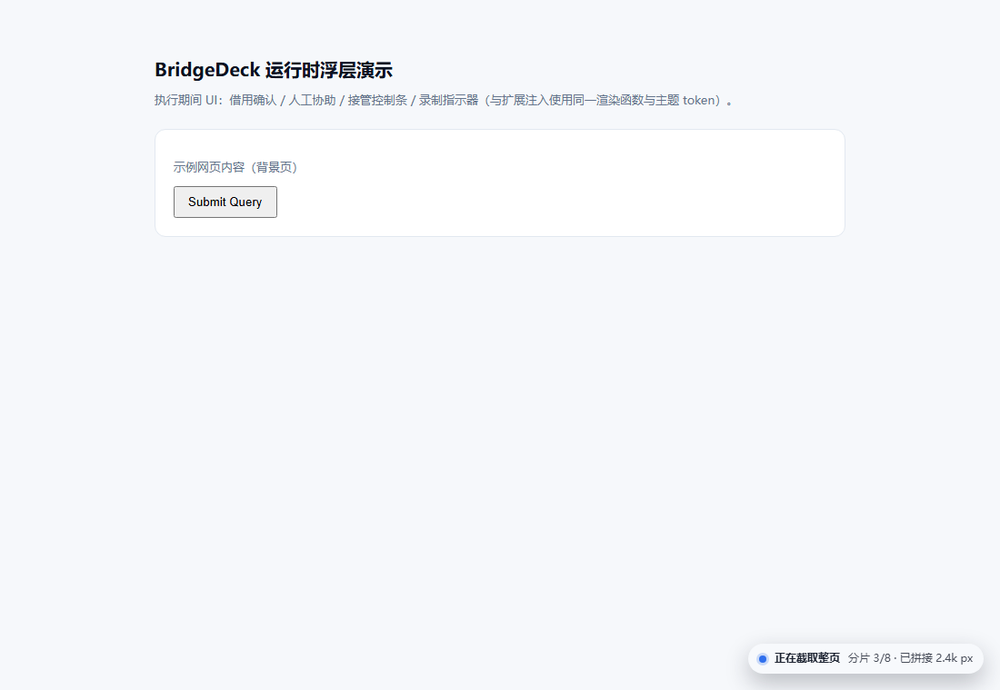 | 采集窗口内未捕获到页面浮层（BSK 的进度在 popup/页面状态，见 popup 截图） |
| 视频录制中 | 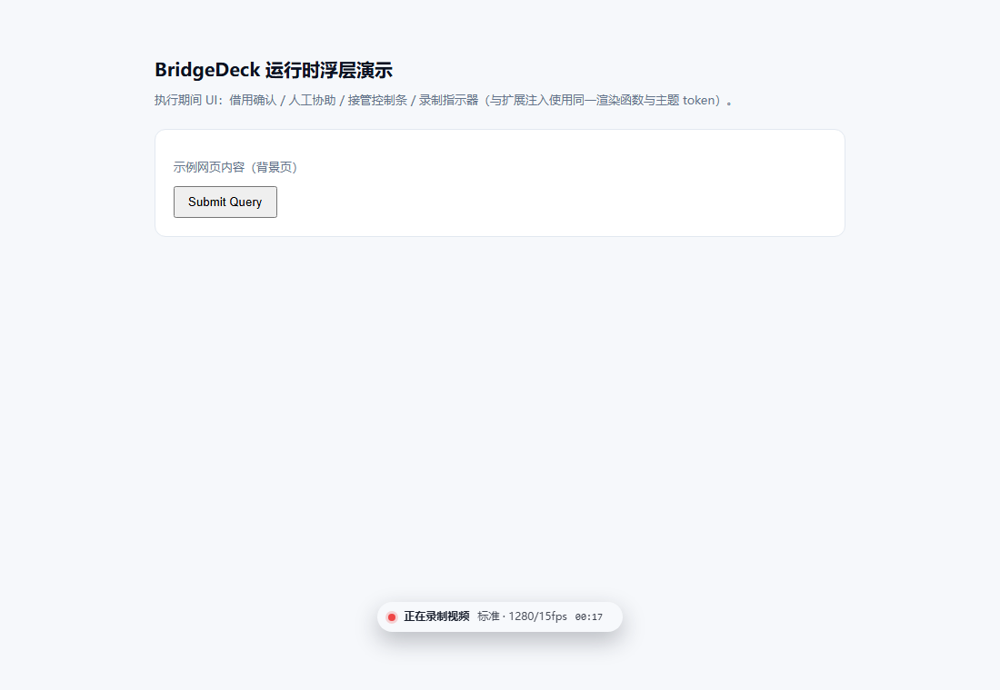 | `video-status-*.png` 为页面本体（BSK 视频状态在 popup 面板） |
| 借用 Toast（紧凑态） | 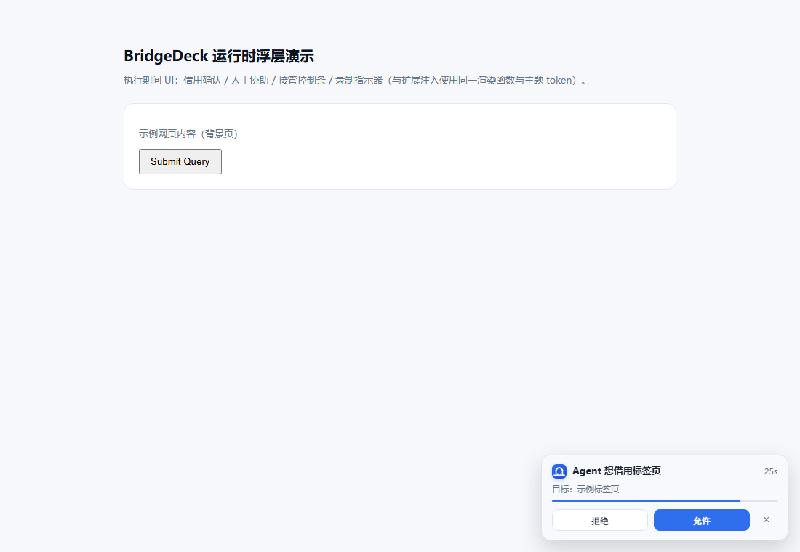 | 参考实现为确认模态 + 系统通知（无 toast 紧凑态） |
| 借用后状态（BSK UIA 尝试） | — | 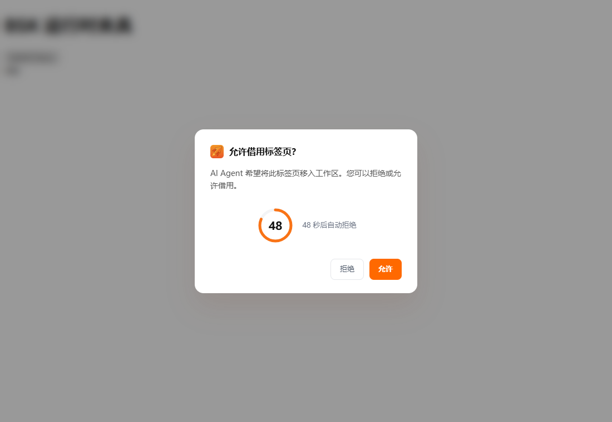（本次 UIA 点击未生效，倒计时仍在；早前差分 harness 里同名 UIA 点击曾成功借用） |

**结论**：
- 我们的执行期状态反馈更“就地”：longshot/video 有右下角统一 chip（进度/计时），借用还有紧凑 toast；
  参考实现把长截图/视频状态放在 popup 面板，页面上只有借用/协助/录制浮层。
- 借用确认的 UIA 可点性在参考实现侧成立（早前差分真实点过 Allow 并成功），本次脚本因窗口焦点/标题差异未命中，
  已如实记录，不当作行为结论。
- 系统通知：我们已有 `action-notifications.js`（借用/协助系统通知 + 按钮 + requireInteraction），
  属于已有的运行时通知能力，与参考实现的系统通知对齐；差异主要在文案密度。

## 9. 状态 chip 运行时接入（视频录制，2026-11-26 晚）

按“把 status-chip 真正接进执行流程”的建议，先接入**视频录制**：

- 新增 `extension/src/video-status-chip.js`（从 video.js 拆出，保持 video.js 的 1100 行复杂度预算）：
  `injectVideoStatusChip(tabId, startedAt)` / `removeVideoStatusChip(tabId)`；
- `video.js` 在录制启动成功后注入 chip（右下角“正在录制视频 · 无声音 · 可预览”，带计时），
  `stopVideo` 时移除；注入失败只记日志、不影响录制；
- `overlay-suppress.js` 的截图隐藏清单加入 `__bb_status_chip_host`，避免污染截图类用例；
- 验证：`tests/unit/video*.test.mjs` 全绿（含 1100 行预算检查）、module-load PASS、unused=0、
  **真实 Edge E2E 222/222 全通过**（含 35/35r 视频录制与恢复用例）。

**仍未做**：长截图 full-page 流程的 chip 接线（涉及 capture 抑制时序，下一轮）、
BSK 借用 UIA 窗口定位重试、audit 数据态注入。

## 10. 运行时浮层逐项差异（除颜色外，2026-11-26 复核）

> 复核方式：同一把生产渲染函数在本地页渲染后截图（我们），参考实现用真实触发 + CDP 截图（BSK）。
> 对照图：`ui-shots-runtime/{borrow,help,takeover,record,toast,longshot,video}.png` ↔
> `ui-shots-runtime/bsk/{borrow-confirm-2,help-card-1,control-overlay,record-overlay-1}.png`。

### 10.1 借用确认（借用模态）

| 维度 | 我们 | BSK 0.5.0 | 判定 |
| --- | --- | --- | --- |
| 卡片尺寸/圆角/内边距 | 400px 宽 / 16px 圆角 / 22×24 padding | ≈394px 宽 / 12px 圆角 / ≈24px padding | 圆角偏大，可收敛到 12–14 |
| 图标 | 22px 蓝色圆角方块 + 桥拱字形 | 24px 橙色圆角方块 + 光标/星形字形 | 字形与尺寸均不同（品牌差异可保留） |
| 标题 | “允许借用标签页？” 15px/700 | 同文案，≈15px/600 | 一致 |
| 正文 | “希望**临时接管**此标签页，**在你的浏览器中操作**” | “希望**将此标签页移入工作区**” | **语义差异**：我们强调“人浏览器里操作”，BSK 强调“移入工作区” |
| 目标行 | 始终显示“目标标签页：…” | i18n 有 targetTab，但面板仅在目标标题可用时显示；截图中无 | 我们信息更多 |
| 倒计时 | 52px 圆环，**数字已居中**（本轮修复）+ “25 秒后自动拒绝” | 56px 圆环，数字居中 + “57 秒后自动拒绝” | 结构已对齐；默认超时不同（我们 30s 级、BSK 60s 级） |
| 非激活态标题 | 无 | titleInactive：“Agent 请求借用标签页” | **缺状态变体** |
| 按钮 | 高 34 / 圆角 9；拒绝=1px 浅描边，允许=实心主色 | 高 32 / 圆角 8；同样“拒绝在左、允许在右” | 尺寸略大 |
| 遮罩/层次 | rgba(15,23,42,.42)+blur3, z 2147483647 | 深色遮罩（背景模糊） | 基本一致 |
| 可访问性 | closed shadow + role=dialog + 焦点陷阱 + Esc 拒绝 | 可访问性树可见（UIA 可点按钮） | **自动化差异**（安全设计取舍） |

### 10.2 人工协助卡片（help）

| 维度 | 我们 | BSK 0.5.0 | 判定 |
| --- | --- | --- | --- |
| 初始位置 | **底部居中**（本轮修复；有目标时锚定目标附近） | 中部偏下居中（截图卡片底边距底部 ≈148px） | 已接近；纵向偏移仍差 ≈120px |
| 宽度/圆角 | 380px / 14px | ≈414px / 12px | 宽度偏窄 |
| 头部 | 20px 图标 + 13px 标题 + 折叠 chevron + 拖拽条 | 24px 图标 + ≈15px 标题 + 折叠 chevron + 拖拽条 | 图标/标题偏小 |
| 标题 | “需要你完成一步操作”（业务传入；默认同） | “Agent 需要你的帮助” | **默认文案不同** |
| 正文/输入框 | prompt + 38px 高、圆角 9、placeholder“给 Agent 留言（可选）” | prompt + ≈40px 高、圆角 8、同 placeholder（i18n 还有 noteLabel） | 基本一致 |
| 按钮 | 右对齐：取消请求(描边) / 完成并交还控制权(实心) | 同顺序、同文案 | 一致 |
| 折叠态 | 只隐藏 body，不显示状态摘要 | 折叠后显示 compactStatus：“当前 Agent 仍在等待你完成此步骤” | **缺折叠态摘要** |
| Esc/焦点 | Esc = 取消请求；焦点陷阱 + 焦点归还 | 支持取消/完成；焦点行为未逐项验证 | 我们更严格 |

### 10.3 接管/控制条（takeover / controlOverlay）

| 维度 | 我们 | BSK 0.5.0 | 判定 |
| --- | --- | --- | --- |
| 位置/宽度 | 右下 16px / 284px / 16px 圆角 | 右下 ≈15px / ≈306px / 12px 圆角 | 宽度偏窄、圆角偏大 |
| 头部 | 品牌 mark + “Agent” + “人机协作”chip + 收起“—” | 橙色方块 + “BrowserSkill” + chip + “—” | 品牌名不同（预期） |
| 状态行 | 圆形循环图标 + “Agent 已就绪” + “你可以随时接手” | 光标图标（橙色底）+ **状态圆点** + “Agent 正在操作” + 副标题 | **缺状态圆点**；图标语义不同 |
| 元信息 | **项目** + 会话（两行，会话等宽字体） | 仅会话一行（i18n 有 project） | 我们信息更多 |
| 主按钮 | “暂停 Agent”（浅蓝实心底，无图标） | “暂停 Agent”（浅橙底 + 暂停 ∥ 图标） | **缺图标** |
| 次按钮 | “停止任务”（描边，无图标；需二次点击确认） | “中断”（描边 + 停止 ■ 图标；interrupt/interrupting 语义） | **语义不同**：我们停任务，BSK 中断当前执行 |
| 状态机 | 8 态（ready/acting/syncing/held/human/editing/yielding/unavailable）+ mini 态 | 控制面板（status/hold/resume/interrupt/中断中） | 我们状态更细 |

### 10.4 录制指示器（recordOverlay）

| 维度 | 我们 | BSK 0.5.0 | 判定 |
| --- | --- | --- | --- |
| 位置 | **左下** 18px | **底部居中** | 位置不同 |
| 内容 | 红点 + 文案 + 计时 00:05 + 红色“结束”文字按钮 | 粉红点 + 文案 + 橙色圆形停止图标（无计时文字） | **结构不同**：我们多计时、按钮是文字 |
| 交互 | Esc 结束；按钮点击结束 | finish 结束（i18n finish） | 等价 |
| 可访问性 | role=status + aria-live + Esc 快捷键声明 | 浮层状态提示 | 我们更显式 |

### 10.5 Toast / 通知 / 长截图 / 视频

| 运行时 UI | 我们 | BSK 0.5.0 | 判定 |
| --- | --- | --- | --- |
| 借用 Toast | 右下紧凑卡：标题/目标/倒计时/进度条/拒绝·允许/关闭 | **无 toast**（仅模态 + 系统通知） | 我们额外提供，非对齐项 |
| 系统通知 | “BridgeDeck · …”，按钮 + requireInteraction | “BrowserSkill：…”，纯文本通知 | 结构对齐，标题前缀/文案密度不同 |
| 长截图 | 页面内手动浮层 + 右下状态 chip（分片/进度） | **popup 面板**：开始/取消/预览/下载、自动/手动说明 | **产品形态不同**（页面内 vs 面板） |
| 视频 | 页面右下状态 chip（计时/规格） | popup 视频面板（状态/原因/预览/保存） | 形态不同 |

### 10.6 本轮实际修复与仍存差异

**已修复（有截图对比）**：
1. 借用确认倒计时数字移入圆环内（52px 环），与 BSK“数字在环内”一致；
2. 人工协助卡片无目标时改为**底部居中**（此前固定在左上角，是布局缺陷）；
3. 重新拿到 BSK 真实协助卡片/控制条截图（此前 help-card 被控制条截图覆盖）。

**保留为产品差异（建议不改）**：品牌名/图标；“停止任务” vs “中断”（语义更明确）；录制计时与文字按钮；借用目标行、项目行等信息增量；借用 Toast。

**建议后续对齐（未改）**：协助卡片宽度 380→400 与纵向偏移；折叠态 compactStatus 文案；借用非激活标题变体；接管状态圆点与按钮图标；卡片圆角 16→12~14、按钮高度 34→32；录制指示器位置（左下→底部居中，需评估与接管/终态 chip 冲突）。

**环境限制**：BSK 本次 control-overlay 截图只有用户窗口；控制条图沿用 borrow 流程中同组件截图（`bsk/control-overlay.png`）。

**更正**：长截图 capture chip 的 `screenshot.js` 接线已因 E2E 31f（稳定页被标 stale）回退；status-chip 组件与视频录制接入保留。

### 10.7 接管/控制条品牌化精修（2026-11-26，按反馈）

按“logo 图标要更新、图案要匹配我们的颜色、悬浮窗要比参考实现更完美”的要求，对运行时浮层做了统一品牌化：

1. **Logo**：接管/借用/协助三处统一使用 BridgeDeck 品牌 mark（渐变蓝底 + 白色桥拱/桥墩/节点），
   尺寸分别 24/24/22px，圆角 7px，带品牌阴影；不再使用旧的单色线框图标。
2. **状态图案（BSK 圆点/图标的位置，用我们的蓝色体系重绘）**：
   - 状态图标从圆形刷新箭头改为 **圆角方形蓝色光标图标**（带 accent 描边）；
   - 状态标题前新增 **品牌蓝状态圆点**：acting/syncing/yielding 态脉冲动画，paused 态转暖色，
     并尊重 `prefers-reduced-motion`；
   - 暂停/停止按钮补 **∥ / ▢ 图标**（currentColor 蓝色体系），保留原有文案与 twice-click 停止确认。
3. **精修细节（比 BSK 更完整）**：卡片 300px/14px 圆角、阴影分层、按钮 34px/圆角 10/渐变主按钮、
   图标 7px 间距、`min` 按钮 hover、项目+会话双行信息、最小化态、双次点击停止确认、a11y live 播报。
4. **测试契约**：保持 `data-status-title/sub`、`data-act`、按钮文案（label span）不变，overlay DOM harness 全绿；
   停止态文案改走 label，图标不再被 textContent 覆盖。

### 10.8 品牌化重做 v2（按反馈修正，2026-11-26 晚）

反馈指出：logo 图形不清楚、状态/按钮图案是照搬参考实现的。已重做：

1. **Logo**：直接采用 `extension/ui/assets/brand-mark.svg` 的精确几何（32 视口：桥拱 + 桥面 + 双桥墩 + Agent 节点/立杆），
   不再用近似线条；借用/协助/接管分别以 28/26/28px 渐变蓝底承载，mark 22px，清晰可辨。
2. **不再照搬参考实现的图案**：
   - 状态图标改为 **“桥两端节点 + 桥面”** 的自有图形（human ↔ agent 的连接桥），不是光标箭头；
   - 状态指示改为 **三格信号条**（品牌蓝，acting 时依次脉冲；paused 转暖色），不是 BSK 的圆点；
   - 暂停 = **桥墩式 ∥**（双墩 + 桥面横线），停止 = **封桥方块**（圆角方框 + 桥面线），全部 currentColor 蓝色体系。
3. **比参考实现更完整**：项目+会话双行、信号条状态、最小化、二次点击停止确认、a11y live 播报、
   prefers-reduced-motion 降级，以及 **卡片 pointer-events 穿透**（不阻挡页面点击，仅按钮/最小化可点）。
4. **回归修复**：加宽卡片后曾拦截 E2E 页面点击（6d 等出现 E_SESSION_PAUSED）；改为穿透后
   **E2E 222/222** 恢复，overlay DOM 测试通过。

截图：`ui-shots-runtime/takeover.png`、`borrow.png`、`help.png`。

### 10.9 对齐项落地（2026-11-26 深夜）

按反馈清单逐项实现：

1. **协助卡片**：宽度 380→**400**；无目标时纵向定位改为视口 **61%**（对齐参考实现），宽度/位置均已在截图核对。
2. **折叠态 compactStatus**：新增 `helpCompactStatus` 文案，折叠后卡片显示“当前 Agent 仍在等待你完成此步骤”（12 语言）。
3. **借用非激活标题**：新增 `borrowInactiveTitle`，页面隐藏（切换标签/最小化）时标题切换为“Agent 请求借用标签页”，可见时恢复原标题（visibilitychange 实时更新）。
4. **接管状态/按钮图案**：保持自有“桥拱 + 信号条”语言（不照搬 BSK 圆点/光标），按钮图标为桥墩式暂停/封桥停止；本轮将按钮高度 34→**32**、圆角 10→**8**。
5. **卡片圆角/按钮**：借用卡片 16→**14**、按钮 34→**32**；协助 14 / 32；接管 14 / 32。
6. **录制指示器**：左下 → **底部居中**（逻辑属性 `inset-inline:0 + margin-inline:auto`，RTL 不命中物理方向）。
7. **视频录制指示**：右下 → **底部居中**，并与录制胶囊**上下错开**（视频 chip bottom 64px），避免两者同时出现时重叠；接管条仍在右下，不冲突。
8. 新增两个浮层翻译键后，语言包为 **12×56**，相关 i18n 测试/契约同步更新。

验证：单元 **5060/5060**、真实 Edge E2E **222/222**。

### 10.10 Logo 再设计：更像“桥”（2026-11-27）

按反馈重绘品牌 mark（`extension/ui/assets/brand-mark.svg` + 三处浮层内联 mark）：

- **去掉节点立杆与顶部圆点**：不再出现类似锁扣的“竖杆 + 圆点”结构；
- **桥墩加长并穿过桥面**：桥墩从拱脚一直延伸到桥面以下，形成“拱 + 双长墩 + 桥面”的桥形；
- 桥拱连接两座桥墩顶部，桥面横线贯穿，整体在 16–22px 下仍可辨认为桥；
- 图标 PNG（16/32/48/128）已用新 SVG 重新栅格化；ours 页面截图基线已更新。

截图：`ui-shots-runtime/takeover.png`（浮层 logo）、`ui-shots/ours/popup.png`（页面 logo）。

### 10.11 Logo 回退与全量排查（2026-11-27）

按反馈：**不使用“桥墩穿过桥面”的那版**，回退到上一轮的桥形（长桥墩到桥面、拱 + 吊杆、无节点立杆）。

同时全量排查 logo 位置，修复漏改：

| 位置 | 状态 |
| --- | --- |
| popup 品牌锁头 | 使用 `assets/brand-mark.svg`（新） |
| options 设置页 | 原为 `icons/icon32.png`（旧）→ 改为矢量 `assets/brand-mark.svg`（24px） |
| 借用确认浮层 | 使用统一 mark（新） |
| **人工协助卡片** | **漏改根因**：CSS 里残留 `.logo svg{width:13px}` 覆盖了 22px 规则，导致看起来还是旧小图标；已删除旧规则（20px） |
| 接管控制条 | 统一 mark（新） |
| **借用 Toast** | **漏改**：仍使用旧线框 SVG（M3 17h18 等）→ 改为统一品牌 mark（20px 渐变底） |
| 页面类头部（workspace/debug/audit/…） | 设计上无 logo（仅标题/返回），不属于漏改 |
| 工具栏/通知图标 | 由 SVG 重新栅格化的 PNG（16/32/48/128） |

截图：`ui-shots-runtime/help.png`（协助卡片 logo）、`borrow.png`、`toast.png`、`takeover.png`；
ours 页面截图基线已更新。

### 10.12 借用 Toast logo 变黑修复（2026-11-27）

- **现象**：借用 Toast 左上角品牌 mark 的桥形是黑色。
- **根因**：Toast 的 logo 容器只设置了蓝色渐变背景，没有设置 `color`；内联 mark 使用 `currentColor`，
  于是继承了容器的正文色 `--bb-fg`（深色）→ 黑色 glyph。
- **修复**：容器补 `color:var(--bb-accent-fg,#fff)`，现在与借用/协助/接管三处一致为白色桥形。
- **全量审计**：`overlay-ui.js` 内 8 处 mark 引用逐一检查——借用/协助/接管原本已有白色前景，
  仅 Toast 遗漏；popup/options 使用矢量 `brand-mark.svg`（内部白色路径），不受影响。

## 11. 快捷功能“操作录制”对比：我们 vs 参考实现

截图（真实扩展 popup，同一套截图链路）：
- 我们：`ui-shots/ours/popup-panel.png`
- 参考实现：`ui-shots/bsk/popup-panel.png`

### 11.1 操作路径

| 步骤 | 我们 | BSK 0.5.0 |
| --- | --- | --- |
| 打开面板 | 快捷功能 → 操作录制 | 快捷功能 → 操作录制 |
| 录制入口 | **开始录制**（当前标签页，一键） | 无“开始录制”；填写“操作主题/起始网址”后 **复制录制指令** |
| 启动方式 | 扩展内直接启动，立即出现“正在录制你的操作”浮层 | 把指令发给 Agent，由 Agent 执行 `record start`，再打开录制窗口 |
| 结束方式 | 面板 **停止** 或浮层 **结束** / Esc | 在录制窗口点“结束” |
| 结果 | 本地 trace（供 Agent/审计使用），可打开完整页查看 | `./trace` 目录包（trace.json + states/），由 Agent 读取 |

**结论：直接录制场景我们更方便**（3 步内开始/停止，无需 Agent）；参考实现更适合“让 Agent 去启动录制”的交接场景。

### 11.2 能力差异

| 能力 | 我们 | BSK |
| --- | --- | --- |
| 一键开始/停止 | ✅ 面板内 | ❌（交给 Agent） |
| 录制主题/起始网址上下文 | ❌ 未在面板采集 | ✅ 主题 + 起始网址写进 prompt |
| 生成给 Agent 的录制指令 | ❌ | ✅ 一键复制 prompt |
| 无需 Agent 独立使用 | ✅ | ❌（强依赖 Agent/CLI） |
| 录制浮层（结束/Esc/计时） | ✅ | ✅（结束按钮） |
| 录制产物 | Trace v3 + 审计/证据 | trace 目录包 |
| 录制 Agent 动作 | 支持（CLI --include-agent 等） | 主要录真人 |

### 11.3 判定

- **不更换**：参考实现的操作录制是“给 Agent 的指令生成器”，不是更省事的直接录制；对我们用户来说多一步依赖 Agent，反而更繁琐。
- **可吸收的优点（建议，不替换）**：在我们的操作录制面板里增加可选“操作主题 / 起始网址 + 复制给 Agent 的录制指令”，保留现有“一键开始录制”，形成“直接录 + 交接录”双路径。
- 若后续实现该增强，需要新增 12 语言文案（面板标签与 prompt 模板），并保持现有 `opsStart/opsStop` 行为不变。

## 12. 快捷功能全景对比与“吸收”落地

### 12.1 快捷功能列表（截图对照）

- 我们：`ui-shots/ours/popup-features.png` —— 视频录制 / 网站调试 / 长截图 / 操作录制 / 操作审计
- 参考实现：`ui-shots/bsk/popup-features.png` —— 完全相同的 5 项

结论：快捷入口层面已对齐；差异集中在**每个功能面板内部**。

### 12.2 本轮吸收：操作录制增加“复制给 Agent 的录制指令”

参考实现的优点：录制面板会生成一段给 Agent 的指令（含操作主题/起始网址）。
我们已吸收（不替换原有更顺手的一键录制）：

- 操作录制面板新增 **“复制指令”** 按钮（复用已有 12 语言词条）；
- 生成英文指令：`bridge record start --json` → 我操作 → `bridge record stop --json` → 读取 trace 总结，并自动附带当前标签页 URL；
- 保留原有 **开始录制 / 停止 / 打开完整页**，普通用户无需 Agent 也能直接录；
- 面板截图：`ui-shots/ours/popup-panel.png`。

### 12.3 其他功能盘点（未发现需要替换的“更好”项）

| 功能 | 我们 | BSK | 处理 |
| --- | --- | --- | --- |
| 视频录制 | 内嵌面板开始/停止 + 完整页/视频库 | 内嵌面板 + 视频库 | 已对齐，保留我们更完整的恢复/分片能力 |
| 网站调试 | debug 页（请求/控制台/性能/规则/证据） | 同类 debug 采集 | 我们更细，保留 |
| 长截图 | 页面内手动浮层 + 分片/DPR/恢复 | popup 面板（开始/取消/预览/下载） | 形态不同；我们的进度 chip 更就地，暂不替换 |
| 操作审计 | audit 页 + 导出/清理/保留策略 | 审计介绍/入口 | 我们更完整，保留 |
| 运行时版本信息 | CLI / Ext 版本 + 实例 ID | daemon/extension/protocol 版本 | 后续可补协议版本展示（小项） |

### 12.4 后续候选（小项）

- 操作录制面板可选“操作主题/起始网址”字段，写进复制指令（需要新增 12 语言词条与 prompt 模板）；
- popup 底部补协议版本；
- 长截图是否也提供 popup 面板入口（保留页面内浮层作为默认）。

## 13. 后续候选补充落地（2026-11-27）

| 候选 | 状态 | 实现 |
| --- | --- | --- |
| 操作录制面板可选“操作主题 / 起始网址”字段 | ✅ | 面板新增两个可选输入；复制给 Agent 的指令中自动带上 `Topic:` 与 `Start URL:`（未填则用当前标签页 URL） |
| popup 底部协议版本 | ✅ | 底部显示 `CLI x / Ext y / 协议 vX`（PROTOCOL_VERSION） |
| 长截图 popup 面板入口 | ✅ 已有 | popup 内嵌长截图面板（自动整页/仅可见、开始截图、打开完整页）；页面内浮层仍为默认 |

新增 4 个 12 语言词条（操作主题/起始网址/示例 placeholder/协议），worklist、11 个语言文件、i18n DICT、LOCALE_TEXT 全量同步。
截图：`ui-shots/ours/popup-panel.png`（主题/网址/复制指令）、`ui-shots/ours/popup.png`（底部协议版本）。

## 14. 操作录制面板改版（对齐参考实现，2026-11-27）

反馈：我们的操作录制面板“没有介绍、不好看”，要求尽可能按 BSK 来。已重做：

- **介绍区**：面板顶部新增完整说明（12 语言），解释“生成指令 → Agent 启动录制 → 你操作 → Agent 读取 trace 自动完成同类任务”；
- **录制给 Agent**：操作主题 / 起始网址两个可选输入（左对齐、整行），下方是**录制指令预览**（等宽字、可滚动只读文本框）；
- **复制录制指令**：主按钮，实时预览会随主题/网址输入更新；
- **直接录制**：分隔线以下保留原有“开始录制 / 停止 / 打开完整页”，普通用户仍可一键录，无需 Agent；
- 视觉：蓝色品牌色系 + 分段标题/分隔线/说明文字层级，布局与 BSK 的信息结构一致。

截图：`ui-shots/ours/popup-panel.png`；参考：`ui-shots/bsk/popup-panel.png`。

新增 5 个 12 语言词条（介绍长句、录制给 Agent、直接录制、指令预览、复制录制指令），worklist/语言文件/DICT/LOCALE_TEXT 全量同步。

## 15. Popup 主面板字体/排版全面对比（2026-11-27）

方法：用 CDP 分别读取两边**真实扩展 popup** 的计算样式（computed style），再对照截图。

### 15.1 测量结果（Popup 主面板）

| 元素 | 我们（改前） | 我们（改后） | BSK 0.5.0 |
| --- | --- | --- | --- |
| body | 13px/19.5 | 13px/19.5 | **12px/18** |
| 状态“已连接” | 13px/600 | **14px/550** | 14px/500 |
| 浏览器名“未命名浏览器” | 13px/600 | **14px/550** | 14px/500 |
| 分段标题“自动化设置” | 14px/650 | **14px/550** | 14px/500 |
| 设置行“借用标签页前确认” | 13px/400 | 13px/400 | 13px/400 |
| 小标签“当前浏览器” | 11px | 11px | 11px |
| popup 宽度 | **340px** | **420px** | **420px** |
| 卡片内边距 | 10×12 | **12×14** | ≈14×16 |
| 段落/区块间距 | 8–10 | **10–14** | ≈10–14 |

### 15.2 快捷功能列表（含快捷功能面板）

| 元素 | 我们（改后） | BSK |
| --- | --- | --- |
| 功能标题 | 13px/550 | 12px/500 |
| 功能描述 | 11.5px/400 | 11px/400 |
| 图标 | 16px + 28px 软底圆角图标块 | 28px 圆角图标块 |
| 行高/间距 | 12px 上下 padding、10px gap | 接近 |
| 面板宽度 | 420px | 420px |

### 15.3 全 UI 面盘点

| 界面 | 我们 | BSK | 结论 |
| --- | --- | --- | --- |
| Popup 主面板 | 已按上表放大字号、加宽到 420、拉开间距 | 420 宽、14px 关键标签 | **本轮对齐** |
| 快捷功能列表 | 13/11.5、图标块，结构对齐 | 12/11、图标块 | 已接近 |
| 操作录制面板 | 介绍/分段/输入/预览/复制/直接录制 | 介绍/prompt/复制 | 已按 BSK 结构重做 |
| 视频/调试/审计/长截图面板 | 12–14px 层级 | 同类 popup 面板 | 字号已同档，结构各自完整 |
| 扩展页面（options/debug/workspace/audit/longshot/record/quick/privacy/preview） | 页面级 13px 基准、标题更大 | 页面 CSS 12px 基准 | 我们略大但可读；本轮不改（避免破坏页面基线） |
| 运行时浮层（借用/协助/接管/录制/Toast/chip） | 标题 13–15px、正文 11.5–13px | 同类浮层约 12–15px | 已同档（见 §10） |
| 系统通知 | 系统渲染 | 系统渲染 | 无排版差异 |

### 15.4 结论

- 主面板此前“字体小、排版挤”的主因是 **popup 宽度只有 340px**、关键标签 13px、标题字重 600–650；
- 现已改为 **420px 宽 + 14px 关键标签/550 字重 + 12–14px 区块间距**，与 BSK 的视觉密度基本一致；
- 快捷功能列表补了软底图标块，字号/行距与 BSK 同档；
- 页面类 UI 保持自有版式（我们页面更多、字号略大），不做统一缩放以免影响既有页面与截图基线。

### 15.5 快捷功能页头/列表排版修正（按反馈）

对比参考实现后发现“快捷功能”标题排版确实不对，原因与修复：

| 问题 | 根因 | 修复 |
| --- | --- | --- |
| 标题离返回箭头很远、看起来居中 | 子视图只隐藏了 `.brand img`，外层 `.brand-logo` 仍占 36px + 两个 10px gap，标题被推到 x≈98 | popup.js 改为同时隐藏 `.brand-logo` 容器；标题回到箭头旁（x≈52） |
| 标题字重过大 | components 里 `.brand h1` 是 16px/780 | popup.css 覆盖为 16px/600、letter-spacing 0 |
| 快捷功能列表套了一层大卡片（双层边框） | `#featuresView` 带 `card` 类 | 去掉外层 card；5 个功能行独立成卡 |
| 功能行底色/层次与参考不同 | 行卡片用灰底 | 改为白底 + 细边框 + 轻阴影 |

修复后（当前）：`ui-shots/ours/popup-features.png`；参考：`ui-shots/bsk/popup-features.png`。

## 16. 页面级 UI 重排（对齐参考实现，2026-11-27）

针对 §3 的页面级差距，新增共享页面品牌层（不改各页功能逻辑）：

- `extension/ui/page-brand.js`：向 `.page-header` 注入品牌行（logo + “BridgeDeck / 页面名”），并把返回按钮移入品牌行；
- `extension/ui/page-brand.css`：页面宽度 560→**1100px**、页面内边距 26/34、标题 16→**26px/700**、副标题 13px、卡片圆角 14、区块间距 14；
- 接入页面：debug / audit / workspace / longshot / ops / record / quick / privacy；options 页仅统一品牌头（24px 标题、760px 宽度）；
- 效果：页面从“窄栏密集工具页”变为“品牌头 + 大标题 + 宽内容 + 大留白”，与 BSK 页面观感一致（BSK 仍更简洁，我们保留更丰富功能）。

截图：`ui-shots/ours/debug.png`、`record.png`、`options.png`、`audit.png`、`workspace.png` 等。

## 17. 浮层无障碍模式（P1，2026-11-27）

- 新增设置「无障碍浮层（读屏可访问）」（options，默认关闭）；
- 开启后接管浮层使用 **open shadow DOM**，并标注 `role=dialog` / `aria-label` / 状态 `aria-live=polite`，读屏与自动化审查可读取；
- 默认仍为 closed shadow，保持页面隔离与防误触；
- 设置项、接管注入、12 语言词条与单测：`tests/unit/overlay-a11y.test.mjs`；options 截图基线已更新。

## 18. 阻塞式录制与 ./trace 目录（P1，2026-11-27）

- 新增 `bridge record start --blocking --out trace`：启动录制后阻塞，等用户在浏览器点停（或 Agent 停止）后自动导出 `trace/trace.json` + `trace/states/*.txt`（BSK 目录形状）；
- 支持 `--purpose`（写入 trace.purpose）、`--redact-values`（步骤值脱敏为 [filled]）、`--max-page-tokens`、`--trace-version 2|3`、`--url`（录制前导航）；
- 非阻塞旧流程保留：`record stop` + `record export` 仍可用；
- 记录持久化 purpose/redactValues/traceVersion/supportsTabSwitchSteps；
- 单测：`tests/unit/record-blocking.test.mjs`。

## 19. 构建瘦身（P2，2026-11-27）

- o200k 词表文本 3.61MB → 前缀压缩二进制 1.41MB（BPE rank 完全一致，encode/decode 单测通过）；
- 扩展 zip 3.67MB → **2.99MB**（约 -18%），运行期优先加载 .bin，保留 .tiktoken 回退；
- 构建排除原始 .tiktoken，生成物校验 `node tools/pack-o200k.mjs --check`。
