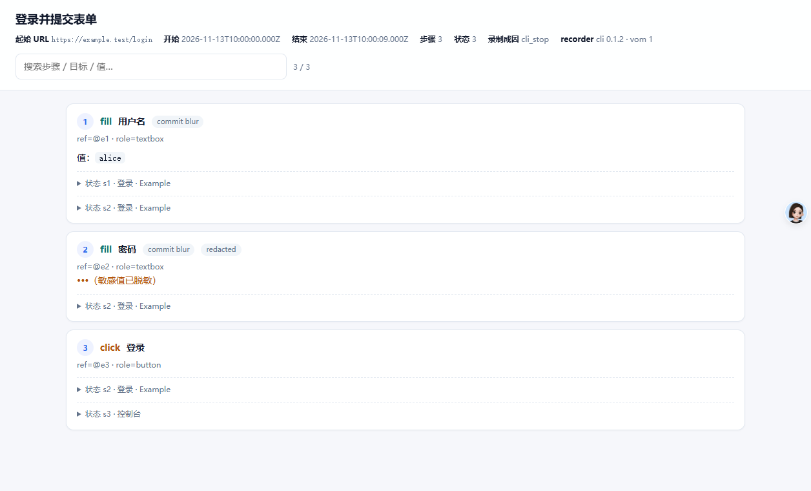

# Trace Viewer

把 `record export` 生成的 Trace v3 变成一个**离线、单文件、零依赖**的 HTML 查看器：步骤时间线、目标、填写/选择值、before/after 状态文本，支持搜索过滤。



## 用法

```powershell
# 1. 录制一段用户操作
bridge record start
# ... 在受控标签页里操作 ...
bridge record stop

# 2. 导出 Trace v3（可同时截一张导出时页面）
bridge record export --out trace --screenshot

# 录制时按步骤截图（最多 30 张缩略图，仅录制页为活动标签页时）
bridge record start --screenshots

# 3. 渲染查看器（可合并 debug 网络证据）
bridge trace view trace/trace.json --out trace/viewer.html

# 可选：把 debug export 的请求列表并入时间线
bridge debug export --output trace/debug.json
bridge trace view trace/trace.json --debug trace/debug.json --out trace/viewer.html
```

不传 `--out` 时默认写到同目录的 `trace.html`。`--json` 返回：

```json
{
  "ok": true,
  "result": { "trace": ".../trace.json", "out": ".../trace.html", "bytes": 7064, "steps": 3, "states": 3 }
}
```

直接用浏览器打开生成的 HTML 即可，不需要 daemon、扩展或网络。

## 能看到什么

- 顶部：用途、起始 URL、开始/结束时间、步骤数、状态数、录制成因、recorder 版本。
- 每个步骤：`fill / click / select / hover / switch_tab`、目标 `@eN`/role/name、`commit`、frame、redacted 标记，以及步骤时间（Trace v3 的 `at`）。
- 填写值：普通值直接显示；`redacted: true` 的步骤显示 `•••（敏感值已脱敏）`，原始值不会进入 HTML。
- before/after 状态：折叠面板，点击展开观察文本（`states[].body`），状态头显示时间。
- 网络时间线（可选）：`--debug <archive.json>` 把 debug 归档里的 `requests` 并入查看器，显示时间、方法、状态、URL、类型；同时按步骤时间窗把请求挂到对应步骤下（`N 个请求 · GET 200 …`）。
- 截图（可选）：`record export --screenshot` 在导出时抓一张当前页面；`record start --screenshots` 在录制时给每个步骤抓缩略图（≤30 张，320px 宽 JPEG）。查看器在步骤内渲染 ``，导出时截图则显示在底部截图区。
- 搜索框：按步骤、目标、值、commit 过滤，右侧显示 `命中 / 总数`。

## 安全

- 所有动态文本（URL、标题、目标名、值、状态 body）统一 HTML 转义，trace 里的 `<script>` 不会执行。
- 敏感值不会写入 `data-search`，避免通过搜索属性泄漏。
- 生成文件权限 `0600`，只写本地；页面带 `noindex, nofollow`。

## 限制

- 按步骤截图是**缩略图**（320px 宽 JPEG、最多 30 张），且只在录制页是当前窗口活动标签页时抓取；用户切走标签页后该步没有截图。它不是无损逐帧证据，需要高清图请用 `screenshot`。
- 导出时截图（`--screenshot`）只有一张，不是每一步的截图。
- 状态 body 可能较大，折叠展示；超大 trace 生成的 HTML 也会相应变大。
- 不做编辑/回放，只读查看。
- `--debug` 的按步骤对齐是**时间窗近似**（当前步骤时间 ~ 下一步时间），不是 CDP 级 commandId 精确关联；跨步骤的慢请求以窗口为准。
- 截图只接受 `data:image/*;base64,`，其他 URL（如 `javascript:`）会被忽略。
